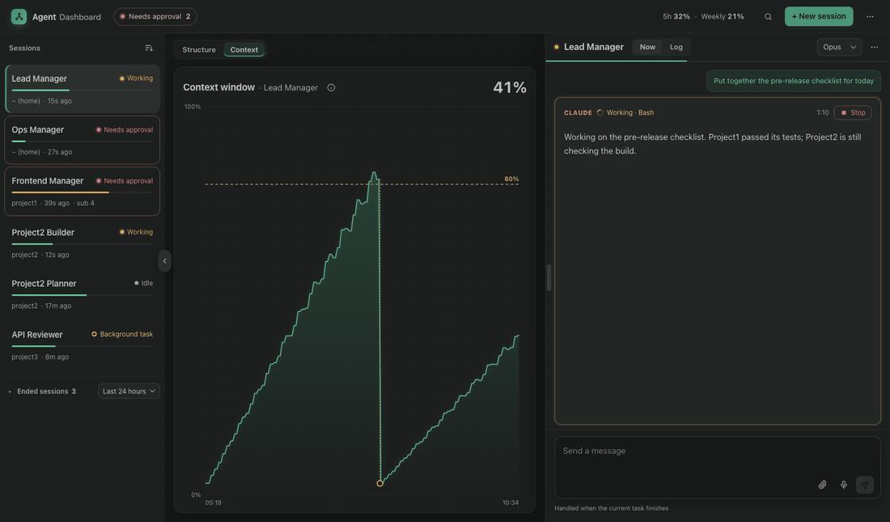
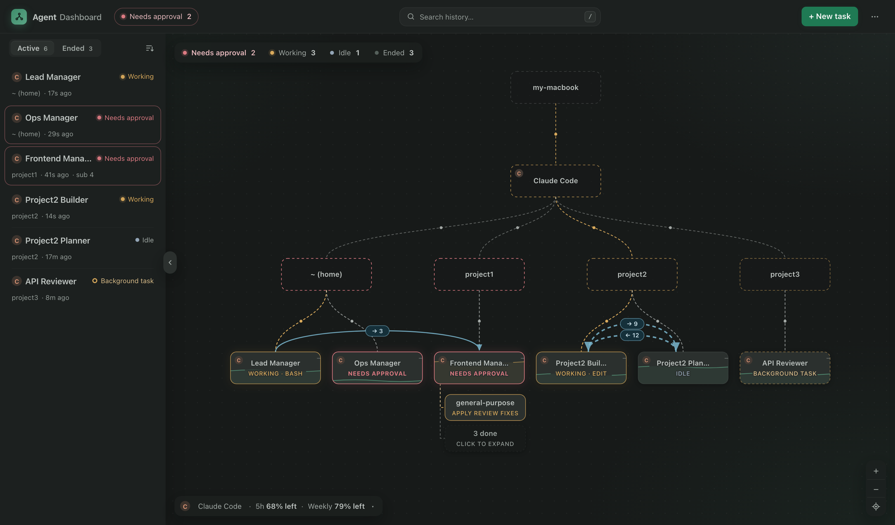
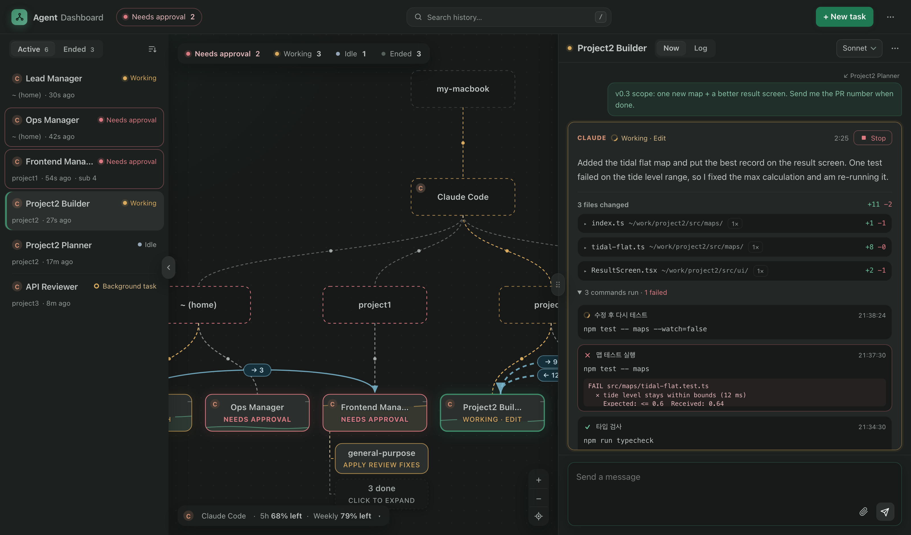
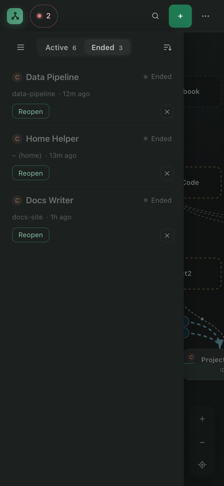

<div align="center">

# Agent Dashboard

**A local dashboard to watch, chat with and approve the AI coding agent sessions running on your Mac — all in one place**

Claude Code · Codex · zero dependencies · everything stays on your machine (the only outside call is a once-a-day check for a new version number)

[한국어](README.md) · **English**

[](https://github.com/Yun7420/agent-dashboard/actions/workflows/test.yml)

</div>

> I built this because I needed it while running many AI coding sessions at once, and I built it **together with an AI coding agent (Claude Code)**. I use it every day and keep improving it.
>
> ⚠️ **This is a personal, experimental tool.** It types into your AI sessions, so please read [Security](#security) first and use it at your own judgment. Features and structure may change without notice.
>

**Roadmap** — ✅ Stage 1: vanilla JS, built fast and used for real · ✅ Stage 2: split files · clean up (two trimming passes), still zero dependencies · ✅ released on npm (npx) · 🔄 Now: daily use and 0.1.x fixes





<sub>Project and session names in the screenshots are sample data from demo mode.</sub>

---

## Why

When you run several AI coding sessions at once, the bottleneck is no longer the AI — it's **you**.

- Terminals are scattered everywhere, so you have to open each one to see **which session is still working**
- A session asks "Can I run this command?" and you find it **stuck for 20+ minutes** much later
- Sessions send instructions to each other, but you can't see **who asked whom to do what**

Agent Dashboard puts all of this on one screen.

## Features

| | Feature | Description |
|---|---|---|
| 👀 | **Live status** | Working · **background task** · idle · **needs approval** · ended, plus the current tool and elapsed time |
| 🗺️ | **Org chart** | This Mac → tool → project → session → subagent. Messages between sessions are **blue arrows** (count + last message) |
| 💬 | **Chat · approve** | Send messages to tmux sessions (Enter), **file/image attachments**. Approval prompts show a **"what you're allowing" card** (warns on risky commands or files outside the folder), the real terminal screen and option buttons; multi-question prompts let you go back and forth |
| ⌨️ | **Shortcuts** | `j`/`k` move between sessions · `/` search everything · `1`–`9` pick an approval option (risky requests need a second press) · `Esc` twice to reject · close |
| ♻️ | **Restore** | Reopen ended sessions in tmux — all at once after a Mac restart (`restore`), or one at a time with "Reopen" on a card in the list's "Ended" tab |
| 📂 | **Open the folder** | Click a project box to open that folder in VS Code · Cursor or reveal it in Finder — no hunting for the folder when you want to check what changed |
| ■ | **Stop · close** | Stop only what a session is doing (the conversation stays), or close a session from the dashboard |
| 📝 | **Live code diff** | Files changed in the current request with +/− counts and red/green diffs; commands with ✓ pass / ✕ fail and output |
| 🧠 | **Model · usage** | Start sessions with an alias such as Fable · Opus · Sonnet · Haiku, switch a running session's model, context usage, Claude account 5-hour/weekly limits (what is left) |
| 🔔 | **Notifications** | Alert when approval is needed or a task over 1 minute finishes — **macOS notifications that arrive even with the tab closed** (choose a sound), or browser notifications when not on macOS; pending approvals in the tab title |
| 🛡️ | **Local-only security** | 127.0.0.1 only, Host/Origin checks, a secret token generated per machine (`~/.agent-dashboard/token`), no framing (clickjacking), path checks for attachments and folders |






## Getting started

### Requirements

You need: **macOS · Node 18+ · tmux · Claude Code**. If something is missing the server still starts and explains it in the startup log and the environment check. The exception is Node older than 18: it explains and does not start (on end-of-life versions — 18 · 20 and all odd versions such as 23 — it prints one line recommending an even LTS (22 · 24 …) and starts anyway). Without tmux it's view-only and the New session · Restore · Close buttons are disabled (hover to see why). If there are no Claude Code transcripts yet, the list shows how to get started.

| | Required | Install |
|---|---|---|
| macOS | yes | Linux is experimental (tests only, in CI); Windows is not supported — see [Supported environment and limits](#supported-environment-and-limits) |
| Node.js 18+ | yes | `brew install node` |
| Claude Code | yes | latest recommended — `brew upgrade claude-code` |
| tmux | for chat/approve | `brew install tmux` (without it, view-only) |

### Run — commands at a glance

Pick one way to use it. **npx** runs it without installing, **install** gives you the short `agent-dashboard` command and autostart, **repo** is for reading the code.

```bash
npm i -g @yun7420/agent-dashboard                                    # to install (once)
git clone https://github.com/Yun7420/agent-dashboard.git && cd agent-dashboard   # to use the repo (once — run its commands in that folder)
```

| What you want | With npx | Installed | From the repo (git) |
|---|---|---|---|
| Start | `npx @yun7420/agent-dashboard` | `agent-dashboard` | `npm start` |
| Stop | Ctrl+C in the terminal that started it | Ctrl+C in that terminal · with autostart, `agent-dashboard autostart off` | Ctrl+C in that terminal · with autostart, `node bin/agent-dashboard.mjs autostart off` |
| Log in again (missed the link · after 7 days · another browser) | `npx @yun7420/agent-dashboard open` | `agent-dashboard open` | `node bin/agent-dashboard.mjs open` |
| Update | Stop it, then `npx @yun7420/agent-dashboard@latest` | `npm i -g @yun7420/agent-dashboard@latest`, then restart · with autostart, follow with `agent-dashboard autostart on` | `git pull`, then restart · with autostart, `git pull && node bin/agent-dashboard.mjs autostart on` |
| Restore sessions after restarting the Mac | `npx @yun7420/agent-dashboard restore` | `agent-dashboard restore` | `node bin/agent-dashboard.mjs restore` |
| Start automatically at login (macOS) | Not available — the npx cache can be cleared, so install it | `agent-dashboard autostart on` | `node bin/agent-dashboard.mjs autostart on` |
| Use another port | `PORT=4600 npx @yun7420/agent-dashboard` | `PORT=4600 agent-dashboard` | `PORT=4600 npm start` |

- Leave the terminal that started it running while you use the dashboard (a cursor that seems stuck is normal) — press **Ctrl+C** there to stop it.
- If you started it on another port, put the same `PORT=` in front of `open` too (the startup log and on-screen hints already include it).
- Why npx updates use `@latest`: without a version, npx may start the copy it cached earlier.
- `agent-dashboard` on npm (without the scope) is an unrelated package. Always use `@yun7420/agent-dashboard`.
> **Good to know** — shutting down or restarting the Mac stops tmux and every Claude session inside it.
> The conversations are saved, so one `restore` line (or the "N sessions were open before the restart" box at the top of the dashboard list, or "Reopen" in the "Ended" tab) brings the same conversations back → [After restarting the Mac](#after-restarting-the-mac)

### What is "login"?

- It isn't a username or password. It's a mark that says **"this browser belongs to the owner of this Mac"**.
- Why it's needed: so other sites open in your browser can't secretly send requests to this dashboard and type commands into your Claude sessions.
- Started from a terminal, it opens a logged-in browser for you (turn that off with `--no-open` or `DASHBOARD_NO_OPEN=1`). If nothing opens, click the login link printed in the terminal.
- **10 minutes** = how long the login link works (once only), **7 days** = how long a logged-in browser is remembered. After that, run the "Log in again" command from the table (details under "Security").

You can also run `node bin/agent-dashboard.mjs` (see `--help`); it's the same as the `agent-dashboard` command you get from npm.

On first launch you'll see an **environment check** and a short guide, with fixes for anything missing (open it again with **⋯ → Help** in the top right).

The **UI language** follows your browser at first (Korean for Korean, English otherwise); pick 한국어 · English under **⋯ → Display → Language**. The choice also applies to terminal logs, macOS notifications and the status line.

Pick the **colors** under **⋯ → Display → Theme**: dark **Green** (default) · **Gray** · **Blue night**, light **Light** · **Warm light**, or **Follow system** (Green when macOS is dark, Light when it's light). Every theme follows the same eye-strain rules (body text 7–10:1, secondary text 4.5:1 or more).

### Keep it running (recommended)

**Start on login (macOS)**: the commands are in the "Start automatically at login" row of the table above — a login item (LaunchAgent) keeps the server running and restarts it 10 seconds after it stops.

- Turn off · check: `agent-dashboard autostart off` · `agent-dashboard autostart status` (on or off, which node it points to, last exit code). Logs go to `~/.agent-dashboard/autostart.log` (readable only by you; over 5 MB it moves to `.1` on `autostart on`). If another dashboard already holds the port, it retries every 5 minutes.
- It can't be set up from npx — the npx cache can be cleared, so the path may be gone after a reboot. If Node lives in a version folder (nvm, fnm), run `autostart on` again after switching Node.
- If the repo is under Documents, Desktop, Downloads (or iCloud Drive), macOS asks once for permission to access that folder — the server doesn't start until you allow it (if you don't see the prompt: System Settings → Privacy & Security → Files and Folders). If `autostart status` says the server is not answering yet, check this first.
- It stores the PATH you had when turning it on, so it finds tmux and claude. If a dashboard is already running (e.g. the tmux runner below) it only warns — use one or the other. On Linux it only prints an example systemd unit.

Or run it inside tmux with the auto-restart runner; if the server stops it comes back after 2 seconds. Logs go to `~/.agent-dashboard/server.log` (readable only by you).

```bash
tmux new -d -s dashboard -c <repo path> node bin/agent-dashboard.mjs run   # the runner
tmux respawn-pane -k -t dashboard     # restart after editing code (sending Ctrl+C would kill the tmux session too)
```

- `run` widens the restart delay to 30 seconds after 5 exits within a minute, and stops instead of restarting when the port is already in use. On Ctrl+C (SIGINT) or SIGTERM it stops the server too.
- Without the repo: `tmux new -d -s dashboard npx @yun7420/agent-dashboard run` (`agent-dashboard run` if installed).

### After restarting the Mac

**What stops**: tmux and every Claude session inside it (and the dashboard too, unless autostart is on). **What stays**: the conversations, plus the list of tmux Claude sessions the dashboard kept saving while it ran (`~/.agent-dashboard/restore.json` — name · folder · session ID). So the same conversations can be reopened (`--resume`).

- **The dashboard**: with autostart on, it starts when you log in. Otherwise use "Start" from the table.
- **All at once**: the **"N sessions were open before the restart"** box at the top of the dashboard list has a **"Reopen all"** button (only ones not running now) — or the "Restore sessions" line from the table (`… restore`). The command also starts a dashboard with the `run` runner if none is running (sessions only if autostart is on or one is already running).
- **One at a time**: the **"Ended"** tab at the top of the list, then **"Reopen"** on a card.

It only starts things and never stops anything. Sessions that are already running aren't started again. Sessions follow your default model; only ones you picked explicitly (e.g. Sonnet) keep it. Conversations older than 30 days are cleaned up by Claude Code and can't be resumed.

Even without a restart, if sessions stopped unexpectedly, check the **"Ended"** tab. Claude sessions that were running in the last 24 hours but aren't now (including ones started outside tmux) get a **"Reopen"** button on their card, which resumes the same conversation in tmux. A view-only session started outside tmux shows a "Reopen" button where the message box would be (it turns on once you close the original).
- Sessions that are running now or were just reopened have no button (no duplicates).
- If the folder trust prompt appears, the dashboard doesn't answer it for you; it only tells you "trust confirmation needed".
- The list lives in `~/.agent-dashboard/recent.json` (readable only by you). The page sends only the session ID; folders and names come only from the server's saved list.

### What's in the data folder

Everything the dashboard writes lives in `~/.agent-dashboard/` (it never writes into the repo or package folder). The folder is yours only (700) and the files are readable only by you (600).

| Name | What | Mode |
|---|---|---|
| `token` | secret token. Delete it and restart to get a new one | 600 |
| `demo-token` | token for demo mode only | 600 |
| `server.log` | server output written by the runner (`run`). Over 5MB it is rotated once to `server.log.1` (the previous one is dropped). Request URLs are logged as paths only (no token or search text) | 600 |
| `restore.json` · `restore-prev.json` | restore-after-reboot lists (now · before the reboot) | 600 |
| `recent.json` | sessions from the last 7 days, for "Reopen" | 600 |
| `update-check.json` | new-version check result (when it last asked · the latest version number — so it asks only once a day) | 600 |
| `notify.json` | notification settings | 600 |
| `settings.backup.<time>.json` · `statusline-original.json` | backup of `~/.claude/settings.json` before turning on usage limits (latest 5 kept) · your original status line | 600 |
| `bin/statusline.mjs` | copy of the usage-limit status-line bridge | folder 700 · file 600 |
| `status/` | values the bridge writes per session (old ones are cleaned up) | folder 700 · files 600 |
| `limits/` | old account limit history (no longer written — deleted after 30 days) | folder 700 · files 600 |
| `uploads/` | attachments (per day, deleted after 14 days) | folder 700 · files 600 |

### Updating

The commands are in the "Update" row of [commands at a glance](#run--commands-at-a-glance). When a new version is out, a startup log line and the "Version" row of the environment check show the right command for how you run it.

### Stopping and uninstalling

1. **Stop the server** — if you started it with `npm start` or `npx`, press Ctrl+C in that terminal. If you used the runner (`run`), press Ctrl+C in its window (the server stops too). To stop the whole tmux `dashboard` session: `tmux kill-session -t dashboard`.
2. **Turn off usage limits** — if it's on, do this **before deleting anything**: hover the limits in the legend's Claude Code item → switch off **Show usage limits** at the bottom of the popup. This puts the status line in `~/.claude/settings.json` back the way it was.
3. **Delete the data folder** — `rm -rf ~/.agent-dashboard`
4. If you cloned the repo, delete that folder and you're done. If you installed it, `npm uninstall -g @yun7420/agent-dashboard`.

> ⚠️ If you jump to step 3 with usage limits still on, `~/.claude/settings.json` keeps a status-line entry that runs `~/.agent-dashboard/bin/statusline.mjs`. That file is gone, so the status line in your Claude sessions goes blank or shows an error. Start the dashboard again and do step 2, or remove `statusLine` from settings.json yourself.

## To chat and approve: start sessions in tmux

A session already running in a terminal has no official way to receive input from outside. The dashboard types into sessions **through tmux, the way a person would**, so **only sessions started inside tmux** can be chatted with, approved or closed. Other sessions are view-only.

```
[Terminal app] ─┐
                ├─▶ [tmux] ── input ──▶ AI session
[Dashboard] ────┘   (manages the input channel)
```

- **New session** — use the **+ New task** button in the dashboard (folder · name · model · first prompt); it opens inside tmux automatically.
- **Move an existing session** — `/exit` in that session, then in a **regular shell**:
  ```bash
  cd <folder where the session started> && tmux new -s name claude --resume <session-id>
  ```
  The conversation continues. Click the session in the dashboard to see the exact command under the input box.
- **tmux basics** — detach with `Ctrl+b` → `d` (the session keeps running) · reattach with `tmux attach -t name`
- ⚠️ Run screen-taking commands like `tmux new …` **one per terminal tab**. If you paste several lines at once, the second line goes into the first session's input. To start several from one tab, use `tmux new -d …`.

## Using the screen

<details open>
<summary><b>Left — session list</b></summary>

- Sort: **manual** (drag cards to fix the order) · by status (recent first)
- Sorting is the small icon at the top right of the list
- Card: name · status + one faint line (folder · time). Context use is shown by the water fill in the org chart nodes; the exact number is in ⓘ session info. Tags only when not the default (Codex · "View only" outside tmux)
- **Collapse the list** with the ‹ tab at the middle of its right edge — a thin rail keeps status dots + initials (› to expand, click to open)
- List tabs **Active N** · **Ended N** — the Ended tab shows sessions that ended in the last 24 hours (with "Reopen"); your tab is remembered. The folded strip shows active sessions only — on narrow screens (860px or less, always the strip) the **☰ button** at the top of the strip opens the list over the org chart with the Ended tab and "Reopen" (closes on outside tap, Esc or picking a session; the Ended status chip opens it too)
- Hover for ✕ (always shown on touch and narrow screens) — close the session (with confirmation) / hide an ended session
</details>

<details open>
<summary><b>Center — structure</b></summary>

- One **org chart** with three groups floating over it: status chips at top left · legend with usage limits at bottom left · + − ⌖ at bottom right
- The org chart fills the whole screen below the header, and the session list and right panel float over it. Opening, closing, resizing or folding a panel **keeps the chart's zoom and position**; only when the chosen session's node ends up behind a panel does the chart slide just enough to show it, at the same zoom.
- Org chart controls: drag to pan · **wheel (two-finger scroll), trackpad pinch or the + − buttons at bottom right (keys `+` · `-`) to zoom** (the wheel stops at 0.75×) · **⌖ Recenter (key `0`)** = put the chosen session in the middle of the visible area at 1×, or fit everything when nothing is chosen · double-click to fit · **click empty space = close the right panel**. Fitting uses the visible area between the panels and never shrinks node text below 12px (if it overflows, the chosen session stays in view and you drag for the rest)
- Session nodes **fill up from the bottom with the context window used** (colour changes at 60% and 85%, the short line on the right = 80%). Hover for "Context 33% · 331K / 1M tokens"
- Dashed line = working in the same folder, yellow = working, **blue arrow = messages between sessions** (when a new message arrives, a glowing dot flies along the arrow once). New session nodes grow slightly into focus, and ended ones fade out where they were — each plays once, and none of it plays with reduced motion
- **Status text color** under each session box: idle = purple · working = yellow · background = light yellow · **needs approval = pink (bold)**
- **Click a project box** to open that folder in **VS Code · Cursor, or reveal it in Finder** (only installed apps are shown; only folders of listed sessions can be opened)
- Subagents: all running ones, finished ones folded into one **"N done"** box (click to expand)
</details>

<details open>
<summary><b>Right — session panel</b></summary>

- Header: status dot · name · **Now / History** tabs · model · ⋯ (ⓘ session info · end session) — widen with the panel edge handle
- A **⋮⋮ handle** on the middle of the panel border: drag to resize, drag past the minimum to fold the panel, double-click for the default width, or focus it and use ← → to resize · Enter to fold. The width is remembered; click a session to reopen (narrow screens: ⋯ → Close panel)
- **Now** tab: last request + **current answer** + **file diffs** + **commands** (✓/✕, output, "show all" for long ones)
- While working, **■ Stop** on the answer card stops the current task only (sends Esc); the session and conversation stay
- **History** tab: past prompts and answers, search, "load more". Every request uses the same bubble with a faint label above it — "You" for yours, "↙ sender" for a message from another session (SendMessage); the Now tab and global search match. Long requests show 4 lines and "More"
- **What I did today**: ⋯ at the top right → Today's work → per session: prompts, edited files, command count, **commit titles** and **tokens** (total · excluding cache; tap the dotted underline or hover for input · output · cache read · cache write · subagents, plus a daily total) (today · yesterday · any date), with **copy as Markdown** for a work log (Claude Code and Codex transcripts; no edited files for Codex). Each response is counted once, and tokens are never converted to money (pricing differs by plan)
- **Context**: shown only by the water fill in the org chart nodes (amber at 60%, red at 85%, short line on the right = 80%). For the exact number, open the panel ⋯ → ⓘ session info: "Context 30% · 300K / 1M tokens · Last auto-compact 11:26". Codex is filled from the token counts in its transcript (token_count); before there is any data (e.g. before the first answer) the node is an empty box
- **Search all history**: type straight into the **search bar** at the top center (or press `/`; 🔍 on narrow screens) and matches from prompts and answers across all sessions drop down below it → pick one with `↑`/`↓` and `Enter` (or click) to open that session's History tab with the same query. `Esc` once closes the list, twice clears the bar
- **Keyboard shortcuts** (also under ⋯ → Help)

  | Key | Action |
  |---|---|
  | `j` / `k` | Next / previous session (within the open list tab, in list order, stops at the ends). If the panel is open, it switches to that session |
  | `g` · `Enter` | Open the chosen session's panel |
  | `/` | Search all history |
  | `+` · `=` · `-` | Zoom the org chart in · out |
  | `0` | Recenter the org chart (⌖ — the chosen session in the middle, or fit everything) |
  | `1`–`9` | Pick that numbered option in an approval prompt. **For requests flagged as risky, press the same number again within 2 seconds** |
  | `Esc` | With an approval prompt shown, press twice within 2 seconds to reject (the first press only says "press again to reject"), otherwise close popups / the panel |
  | `Enter` · `Shift+Enter` | In the message box: send · new line |
  | `←` `→` · `Enter` | With the panel handle focused: resize · fold |

  Shortcuts are off while typing, during Korean IME composition, with Ctrl/⌘/Alt, on key repeat, and while a dialog (search etc.) is open.
- Answers render **bold** · `code` · headings · **tables** (`| head |` + `|---|`) · **lists** (`-` · `1.`, one nesting level) · **quotes** (`>`) · **code blocks** (fenced with three backticks). Wide tables and long code scroll horizontally inside the block. The **copy button** at the top right of a code block copies just the code, without the backticks or language name (on wide screens it shows on hover or focus; on touch or narrow screens it is always visible).
- Input: **Enter** to send · Shift+Enter for a new line · 📎 attach (drag & drop or ⌘V, up to 25MB · click an image chip to see it large). A one-line slash command (e.g. `/compact`) is sent as a command
  - Type `/` at the start to get a command list: built-in commands that work over dashboard chat (based on Claude Code 2.1.323 — the environment check tells you if your version differs) + your commands, skills and enabled plugin commands from that session's folder and `~/.claude` (only names and descriptions are read). ↑↓ to choose · Enter/Tab to insert · Esc to close; you send it yourself. Commands not in the list can still be sent as typed. Commands that open a settings screen (`/config` etc.) are left out because that screen would swallow your next message — use them in the terminal
- Drafts and attachments are kept **per session** — switching sessions shows that session's own, so nothing goes to the wrong session. Text survives a reload (stored only in your browser); attachments need to be added again after a reload. They're cleared when the session ends
- Needs approval: a **"what you're allowing" card** on top (run command · edit/write file · web · MCP · question — the full command, or the file path relative to the session folder, flagged if outside it), then the real terminal screen and option buttons. For `rm -rf` · `sudo` · `git push --force` · `git reset --hard` · `curl | sh` · `chmod 777` · files outside the folder · `.env`/key files the card turns **amber** with a one-line reason. **Check what you're allowing before you click.** The approval view fills the panel with the input pinned at the bottom, and keeps your scroll position while you read.
- Multi-question prompts show **← Previous / Next →** and progress (✓ answered). You can go back to change an answer; you can't skip ahead before answering the current one.
- Options all look the same until you pick one; **only the picked answer turns purple with ✓**.
- Messages aren't sent while approval is pending (so your text can't land in the prompt by accident).
</details>

<details open>
<summary><b>Header — approval · limits · ⋯ menu</b></summary>

- "Needs approval N" (hidden at 0, click to open the first waiting session) · search bar · + New task (run an agent) · ⋯
- Three groups float over the org chart, like a map app: **status chips at top left** ("● Needs approval 0 · ● Working 2 · ● Idle 6 · ● Ended 2"; click one to open the first session in that state — Ended first switches the list to the Ended tab; Needs approval is dimmed at 0 and highlighted from 1), **the kinds legend with usage limits at bottom left**, and **+ · − · ⌖ at bottom right** (they follow the right panel's edge). Narrow screens (860 or less, phones) use the same places.
- Account usage limits sit inside the **Claude Code** item of the bottom-left legend as "· 5h 68% left · Weekly 79% left" (amber at 40% left or less, red at 15% or less). When the visible area between the list and the panel runs short, the legend shrinks first to "C 68% · 79%" (▾ — tap or hover for the full popup), and if that is still not enough the status chips keep only dots and numbers — nothing is hidden.
- The connection shows only when it drops
- **Esc**: close popups → press again to collapse the panel
- ⋯ → Notifications: notification settings (approval needed · task over 1 minute finished) — one on/off switch · sound · test notification. On macOS the server sends macOS notifications (even with the tab closed); elsewhere (Linux etc.) the same switch turns on browser notifications (while this tab is open). Only one route is used, so you never get two. The same session and reason alerts at most once a minute, and simultaneous alerts are merged into one. Settings live in `~/.agent-dashboard/notify.json` (readable only by you). macOS notifications may need notification permission for Script Editor (or Terminal)
</details>

## Model · usage

- **CPU · memory** — the header chip "CPU 23/100% · Memory 13.7/16GB" is the whole computer (all cores = 100%; memory counted like Activity Monitor's "Memory Used", colored when memory pressure is warning or critical). Each session's values are always shown as two lines under its map node, "CPU 35%" and "Memory 480MB" (the session plus child processes such as tests, builds and dev servers; one core = 100%). When heavy (above 80% CPU or 1.5GB twice in a row) that line is highlighted, and it goes back after two readings below 60% · 1.2GB. The heaviest child (program name only) is in ⓘ session info
- **Model** — choose in + New task (the New task window); change a running tmux session's model from the panel header (sends `/model`). Claude's `/model` also saves your default model, so when you change it from the dashboard **only that session** changes and your default is restored automatically.
  - What you pick is an **alias** (Fable · Opus …) = the latest model of that family. The alias list is read automatically from Claude Code's `claude --help` (again when the Claude Code version changes) — if it can't be read, the default list is used and the environment check says so. Running sessions also show the actual version (e.g. `Opus (5.5)`).
- **Account usage limits (5-hour · weekly)** — turn on and off with the **Show usage limits** switch in the Claude Code item of the legend. Only the first time you turn it on, a line "Connects a status line in Claude settings (~/.claude/settings.json) · turning it off restores it" and a **Connect** button appear; once connected, that browser turns it on directly. Turning off happens right away, with no confirmation, and restores your original status line. Claude Code only passes this to the status line, so turning it on registers a status line (`bin/statusline.mjs`) in `~/.claude/settings.json`.
  - Every Claude session gets one line at the bottom: `model · context % · 5-hour limit %` (if you already had a status line, it keeps showing yours).
  - Your previous settings are backed up to `~/.agent-dashboard/` and **restored exactly** when you turn it off. While on, context usage becomes exact instead of estimated.
  - When turned on, the status-line script is copied to `~/.agent-dashboard/bin/statusline.mjs` and that path is registered (so moving or deleting the dashboard folder doesn't break your status line). A newer version refreshes the copy automatically, and an older registration is switched to the new path. If the node or copy path contains a quote, `$`, `` ` `` or `\`, it refuses to turn on and tells you why.
  - The status line is registered with the node path at the time you turned it on (with Homebrew, `…/Cellar/node/<version>/…`). Upgrading node can remove that path and stop the limit readings. The environment check's "usage limits" row shows the status line's node path and version, and warns if it can't run. Restarting the dashboard switches it to the current node.
  - If `~/.claude/settings.json` is a **symlink** (e.g. to your dotfiles), on/off is refused with "the settings file is a link" so the real file it points to isn't edited behind your back. Register it in the linked file yourself in that case.
  - While on, hover the limits in the legend (tap them on touch screens) to open, just above the legend, **what is left and when it resets** per window ("5h: 68% left · resets in 4h 27m", or "resets Sun, Nov 22" when more than a day away) with a bar, plus the as-of time and the **Show usage limits** switch (on). No history is recorded any more (old `~/.agent-dashboard/limits/` files are deleted after 30 days).

## Security

- **`127.0.0.1` only** — requests whose Host isn't localhost are rejected (blocks DNS rebinding). Prompts and code paths are visible, so don't share the address.
- **`~/.agent-dashboard/token`** — a secret token just for this dashboard. It's generated per machine on first run (readable only by you, 600) and is **never put in the page** (anyone can fetch the page files — including other accounts on the same Mac).
  - **Login**: only a browser that arrives through a **login link** (valid 10 minutes, once — a second visit says it was already used) made from this token gets a cookie. The link is printed in the terminal on start; later the `open` command ("Log in again" in the table above) opens one for you. The link immediately redirects to `/`, so it doesn't stay in the address bar or history.
  - The cookie can't be read by page scripts (HttpOnly), isn't sent with requests from other sites (SameSite=Strict) and expires after 7 days. Its value is a signature made with the token, not the token itself.
  - Reading history and sending commands (send, approve, close …) require login. The page's requests carry a header other sites can't add, and requests from pages on other ports of this Mac are rejected too.
  - Before handing over the link, `open` checks that the server on that port really is this dashboard (an answer signed with the token). If another program grabbed the port, the link is not sent. The server listens on both `127.0.0.1` and `[::1]` so another program can't take over the IPv6 side of `localhost`. If another program is already using the same port on `[::1]`, the server explains why and doesn't start (otherwise open tabs could send it the cookie).
  - Don't share it. If it leaks, delete the file and restart: you get a new token and every login is ended.
  - Older versions kept it in `.dashboard-token` inside the repo folder. On first start the value is moved to the new place once and the old file is deleted (open tabs keep working). A token file that is a symlink is never used.
- Attachments outside `~/.agent-dashboard/uploads/` are rejected (symlinks are resolved first, and missing files are rejected too), and attachments are **deleted automatically after 14 days**.
- Open folder (VS Code · Cursor · Finder) only opens **folders of sessions currently in the list**; any other path sent by the page is rejected.
- New session · open folder · restore only use **folders under your home folder**. Symlinks are resolved first, so a link inside your home pointing outside it (e.g. to `/etc`) is rejected.
- Aborted or oversized requests are rejected right away (body limit 413, attachments 25MB). If an upload is cut off midway, no half-written file (`.part`) is left behind.
- The `~/.agent-dashboard` folder is yours only (700), and the files in it (log, settings backups, restore list) are readable only by you (600). On start the server also tightens older folders, subfolders and files that were created wider (only narrowing; symlinks are not followed).
- Reading the session list and history also requires the same login as commands (so other accounts or programs on the same Mac can't read your conversations).
- Every response carries `X-Frame-Options: DENY`, `frame-ancestors 'none'` and `nosniff`, so another website can't load this page in a hidden iframe and trick you into clicking approve.
- A Content Security Policy limits the damage if a bug (XSS) ever slips into the page: scripts only from this server (`script-src 'self'`, no inline scripts or onclick), connections only to this server (`connect-src 'self'`), no plugins or `<base>`, and `Referrer-Policy: no-referrer`.
- **The only outside connection**: once a day at startup it asks npm for this package's latest version number (fixed `registry.npmjs.org` address, 3-second limit). Nothing about you is sent (the only header is `agent-dashboard/<version>`). It never downloads or installs anything — if a newer version exists it just says so in one startup log line and in the "Version" row of the environment check. The result is remembered in `~/.agent-dashboard/update-check.json` (600), so it doesn't ask again within a day. To turn it off, start with `DASHBOARD_NO_UPDATE_CHECK=1` (or `NO_UPDATE_NOTIFIER=1`) — for autostart, set it and run `autostart on` again.
- Permission modes follow your own Claude settings. The dashboard never uses permission-skipping flags.
- A new session's first prompt is never passed as a claude argument (arguments are visible to other accounts on this Mac via `ps`). Once the session's input box appears (usually about a second), it is pasted through a tmux buffer, so text starting with `-` (e.g. `--permission-mode …`) can't be read as an option either. If the folder-trust prompt is showing, the card says so and it waits (up to 10 minutes) for your answer. If it still can't be delivered, your text is put back into that session's input box (or the first-prompt box of New task if the session already closed) and a notice tells you.

## How it works

It doesn't touch hooks or global settings — it **only reads**. Two exceptions: one status line if you turn on usage limits, and after you switch a session's model in the panel, putting the `model` line that Claude Code rewrote in `settings.json` back as it was.

| Reads | To learn |
|---|---|
| `~/.claude/sessions/*.json` (falls back to `claude agents --json`) | live sessions and their exact state |
| `~/.claude/projects/**.jsonl` · `~/.codex/sessions/**.jsonl` | prompts · answers · tools · changed files · model · context · subagents · messages between sessions |
| `ps` · `lsof` · `tmux` | running processes, working folders, prompts on screen (detected by the `Enter to …` / `Esc to cancel` line at the bottom) |

- Updates use **SSE** — the server builds the state every 2 seconds and sends it **only when something changed**.
- Transcript files over 100MB are read **incrementally** (only the new part). How long building the state takes is shown at `/api/perf` (with server memory) — on the author's Mac in daily use, median 37ms and max 88ms over the last 30 ticks (2026-11-13).
- The history tab loads **80 items at a time** from the server (search is filtered server-side too). The history cache keeps only the 30 most recently opened sessions for 30 minutes, so it doesn't grow while the dashboard stays up.
- The screen redraws only what changed, the history tab renders 80 items at a time, and the flowing dashed lines update 8 times a second and pause when the tab is hidden.

```
agent-dashboard/
├─ server.mjs          # start the server · security checks at the request entry (Host · origin · login) · route table (ROUTES) · static files · wiring the areas together
├─ adapters/           # per-tool differences only — claude.mjs (+ claude/ pieces) · codex.mjs (+ codex/ pieces: today's work · record format) · index.mjs
├─ lib/                # one job per file
│  ├─ live-feed · state · procs · tmux · dialog · approval   2-second tick · SSE · build state · process list · tmux control · prompt detection · "what you're allowing" card
│  ├─ dialog-watch · peer-links                   watching for prompts (every other tick · mismatch log) · linking messages between sessions
│  ├─ commands · spawn · models · open-dir · env · launch  commands (chat · approve · new session …) · new-session args · model alias list · open folder · environment check · hints matching how you started it
│  ├─ body · uploads · respond · validate         request bodies · attachments · response shapes · input checks
│  ├─ token · auth · login-open · paths · accounts · perms    secret token · login link · cookie · open (server check) · paths (inside-folder checks) · other accounts · tmux servers (configured only) · file permissions
│  ├─ usage-bridge · claude-settings · bridge · status · limits · usage   usage limits (status-line bridge · keeping the default model · clearing old limit history · token totals)
│  ├─ i18n · i18n-en · lang-pref · atomic-write   server text in two languages (dictionary) · terminal · notification language · safe file writes
│  ├─ command-risk · node-check                   risk check for approval cards · Node version check at start
│  ├─ recent · restore · restore-cli · runner · autostart     restore · restore after reboot · runner · start on login
│  ├─ slash-commands                              the "/" list in the message box (built-in commands + names · descriptions of your commands, skills, plugin commands)
│  ├─ history-core · history-api · git-commits    shared transcript reading (new lines only · grouping into turns — adapters only interpret lines) · history tab · search · today's work · commit titles
│  ├─ notify · notify-api · housekeeping           notifications (what and when · settings · routes) · cleanup at start and every 6 hours
│  ├─ paging · filecache · lru · serial · lock · util   paged history · caches · ordering
│  └─ demo · demo-en                              demo data (both languages)
├─ bin/                # agent-dashboard.mjs (start · run · restore · open · autostart) · statusline.mjs (status-line bridge source)
├─ public/             # UI (vanilla HTML/CSS/JS, no build)
│  ├─ index.html       # structure (no token — login is a cookie)
│  ├─ css/00-base.css ~ 12-narrow.css   # styles, one file per area, loaded in number order (narrow-screen @media in the last file)
│  └─ js/00-dict-*.js ~ 21-slash.js # behavior — UI language (dictionary · t()) · saved settings (00-prefs) · one file per area (list · org chart · history · attach · notify · restore · search · today · shortcuts …), loaded in number order
└─ test/               # node --test · _helpers (temp folders · starting servers · requests) · fake-bin (fake tmux · claude · ps · lsof · open · osascript)
```

What each file does, the path of one request and where the security checks sit are in the [code map (docs/ARCHITECTURE.md, Korean)](docs/ARCHITECTURE.md).

### Adding another agent

Add a file with the same shape to `adapters/` and one line to `adapters/index.mjs`. See the comments in `adapters/index.mjs` for the shape.

### Demo mode (screenshots, talks)

```bash
DEMO=1 PORT=4646 npm start
```

Shows the UI with fake data (Project1, Lead Manager, …). No commands are executed. The images in this README were taken in demo mode.


### Tests

```bash
npm test
```

Uses Node's built-in test runner (`node --test`), nothing to install. The tests cover transcript parsing · prompt detection · risk checks on approval cards · security (token, Host, Origin, paths, file permissions) · commands · restore · runner and more.
- Test servers briefly use ports 4683 and 4690–4699. Instead of real sessions and tmux they use a temporary home folder and the fake commands in `test/fake-bin` (tmux · claude · ps · lsof · open · osascript), so your `~/.claude` and `~/.agent-dashboard` are never touched.
- GitHub Actions runs `npm test` on every push to main and every PR, on Ubuntu · macOS × Node 18 · 20 · 22 · 24 (badge above). Real macOS notifications (osascript) are tested only on macOS; the "approval needed → notification" wiring is also tested on Linux with a fake osascript.

## Supported environment and limits

| Item | Supported | Limits |
|---|---|---|
| OS | **macOS** (where it's built and used daily) | **Linux is experimental** — sessions come from `ps`, working folders from `/proc` (or `lsof`), folders open with `xdg-open`, and there are no macOS notifications. Only the tests run there (CI). **Windows is not supported** — it explains why and exits (Linux inside WSL counts as Linux) |
| Node.js | 18 or later (22 · 24 recommended) | Below 18 it won't start. 18 · 20 and odd versions are end-of-life, so it prints one line and starts |
| tmux | Built assuming 3.0 or later (used daily on 3.6) | The default socket is always read. For servers started with `tmux -L name` · `-S path`, list them in `DASHBOARD_TMUX_SOCKETS=socket:socket` and their sessions show up, with chat · approve · close sent to that server (the socket for `-L name` is `/tmp/tmux-$(id -u)/name`). Only sockets you own that aren't symlinks are accepted; nothing is discovered automatically. New sessions go to the default server |
| Claude Code | Latest recommended (used daily on 2.1.323 · format changes show a warning in the environment check) | Status comes from the `~/.claude/sessions` files; older versions without that folder use `claude agents --json`, and without that it guesses from processes (weaker "needs approval" detection). Prompts are detected from the **English screen text**. If record or session file shapes look different, the "Record format" · "Session file format" lines in the environment check turn into warnings (with the checked and current versions) |
| Record folders | Folders moved with `CLAUDE_CONFIG_DIR` · `CODEX_HOME` | By default the one value of the shell that started the dashboard. Add other account folders with `DASHBOARD_CLAUDE_DIRS=~/.claude-work:…` (only folders under home, owned by you, not linking outside — others are skipped with the reason in the environment check). Sessions · history · search · reopen work per account; usage limits · default model · new sessions use the default account; Today's work is combined. Codex reads one folder |

- **Chat · approve · close work only for sessions started in tmux.** Sessions started in a plain terminal or an editor extension (VS Code · Cursor) are view-only.
- **It opens the browser by itself only when started from a terminal.** With autostart, the runner (`run`) or `--no-open` it doesn't, so open the login link printed in the terminal or run the `open` command ("Log in again" in [commands at a glance](#run--commands-at-a-glance)). If you started it with `run` (the runner), the link is in `~/.agent-dashboard/server.log`.
- If a project's `.claude/settings.json` has its own `statusLine`, sessions in that project don't get account usage limits (the status-line bridge isn't called).
- **Codex is partial** — list · status · Now tab (request · answer · context) · History tab · search · chat · **Today's work** (prompts · commands · commits · tokens — edited files are not in its transcripts, so they show "not supported") · the "Codex record format" environment check work (verified with 0.125 transcripts). Prompt detection · account usage limits · last auto-compact time · subagents · messages between sessions · new session · restore are Claude Code only.
- No Gemini or other tools yet (each can be added as one adapter file).
- **This Mac only.** The server listens on `127.0.0.1` only; there is no access from other devices or remote access (login · tunnels · cloud).
- File diffs come from the Edit/Write tools. Files changed by shell commands only show up under "commands".
- If several sessions start in the same folder without `--resume`, they're matched by process start time. After `/clear` in a long-running session they can occasionally get mixed up.
- If Claude Code changes its transcript format, some details may be wrong (only the adapter needs fixing).
- Prompts are detected from Claude Code's English hint line at the bottom of the screen **or** from numbered options with a cursor (❯). If one of them changes the other still catches it, and when the signals (including the official status) disagree, the **"Approval detection"** row in the environment check turns into a warning.

## If something goes wrong

Please use the [bug report form](https://github.com/Yun7420/agent-dashboard/issues/new?template=bug_report.yml). Open ⋯ at the top right → Help → **"Copy check results"** and paste it in (it only has versions and check results — no paths or session names). For security issues, please report [privately](https://github.com/Yun7420/agent-dashboard/security/advisories/new) instead of opening a public issue.

## License

[MIT](LICENSE)

This is an unofficial personal project and is not affiliated with or endorsed by Anthropic, OpenAI or Google. Claude, Claude Code, Codex and Gemini are trademarks of their respective owners.
