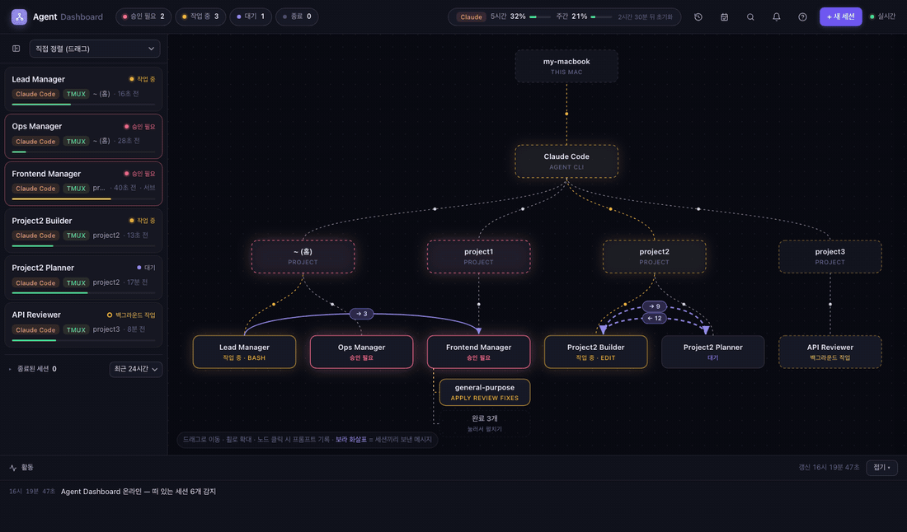
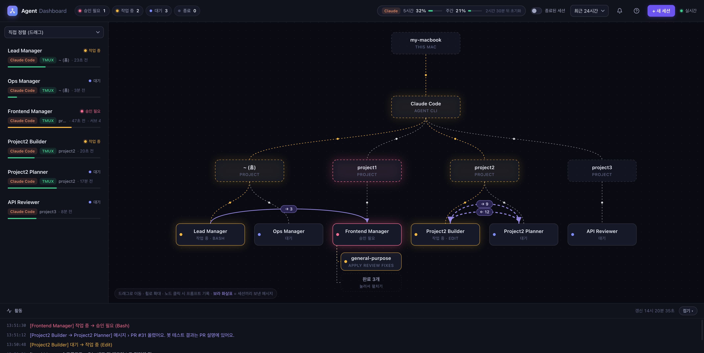
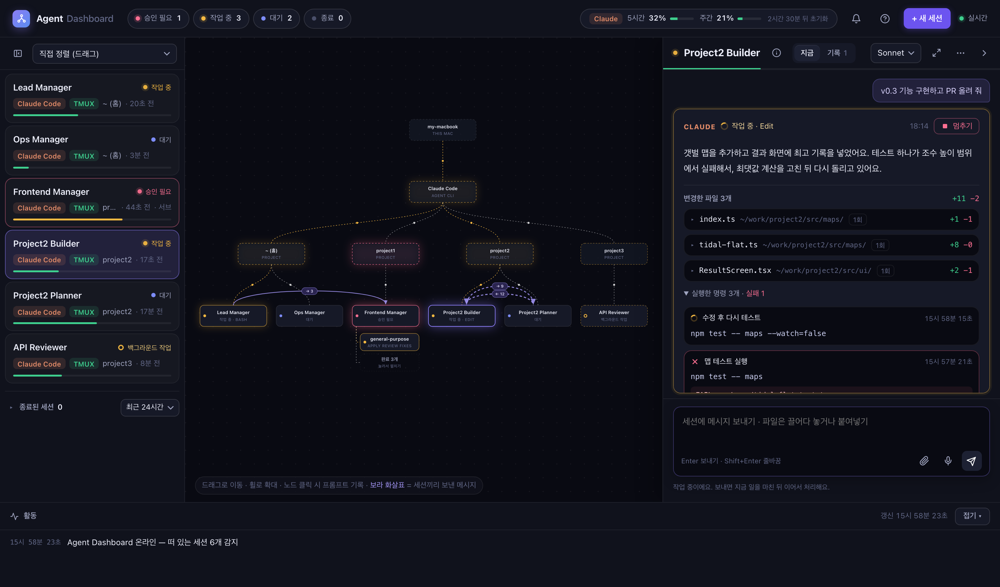
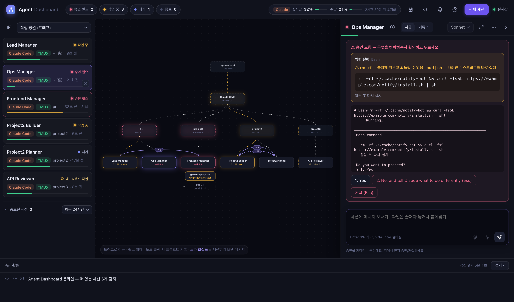

<div align="center">

# Agent Dashboard

**A local dashboard to watch, chat with and approve the AI coding agent sessions running on your Mac — all in one place**

Claude Code · Codex · zero dependencies · everything stays on your machine

[한국어](README.md) · **English**

[](https://github.com/Yun7420/agent-dashboard/actions/workflows/test.yml)

</div>

> I built this because I needed it while running many AI coding sessions at once, and I built it **together with an AI coding agent (Claude Code)**. I use it every day and keep improving it.
>
> ⚠️ **This is a personal, experimental tool.** It types into your AI sessions, so please read [Security](#security) first and use it at your own judgment. Features and structure may change without notice.
>
> 🌐 **The UI is currently in Korean.** The screenshots below show what each part does.

**Roadmap** — ✅ Stage 1: vanilla JS, built fast and used for real · 🔄 Stage 2: split files (done) · clean up (in progress), still zero dependencies · ⏳ Stage 3: move to React





<sub>Project and session names in the screenshots are sample data from demo mode.</sub>

---

## Why

When you run several AI coding sessions at once, the bottleneck is no longer the AI — it's **you**.

- Terminals are scattered everywhere, so you have to open each one to see **which session is still working**
- A session asks "Can I run this command?" and you find it **stuck for 20+ minutes** much later
- Sessions send instructions to each other, but you can't see **who asked whom to do what**

Agent Dashboard puts all of this on one screen.

## Features

| | Feature | Description |
|---|---|---|
| 👀 | **Live status** | Working · **background task** · idle · **needs approval** · ended, plus the current tool and elapsed time |
| 🗺️ | **Org chart** | This Mac → tool → project → session → subagent. Messages between sessions are **purple arrows** (count + last message) |
| 💬 | **Chat · approve** | Send messages to tmux sessions (Enter), voice input, **file/image attachments**. Approval prompts show a **"what you're allowing" card** (warns on risky commands or files outside the folder), the real terminal screen and option buttons; multi-question prompts let you go back and forth |
| ⌨️ | **Shortcuts** | `j`/`k` move between sessions · `/` search everything · `1`–`9` pick an approval option (risky requests need a second press) · `Esc` reject · close |
| ♻️ | **Restore** | Reopen ended sessions in tmux — all at once after a Mac restart (`restore`), or pick from sessions that ended in the last 7 days with the restore button in the header |
| 📂 | **Open the folder** | Click a project box to open that folder in VS Code · Cursor or reveal it in Finder — no hunting for the folder when you want to check what changed |
| ■ | **Stop · close** | Stop only what a session is doing (the conversation stays), or close a session from the dashboard |
| 📝 | **Live code diff** | Files changed in the current request with +/− counts and red/green diffs; commands with ✓ pass / ✕ fail and output |
| 🧠 | **Model · usage** | Start sessions with Opus · Sonnet · Haiku, switch a running session's model, context usage, Claude account 5-hour/weekly limits and their trend |
| 🔔 | **Notifications** | Alert when approval is needed or a task over 1 minute finishes — browser notifications, or **macOS notifications that arrive even with the tab closed** (choose a sound); pending approvals in the tab title |
| 🛡️ | **Local-only security** | 127.0.0.1 only, Host/Origin checks, a secret token generated per machine (`~/.agent-dashboard/token`), no framing (clickjacking), path checks for attachments and folders |





## Getting started

### Requirements

You need: **macOS · Node 18+ · tmux · Claude Code**. If something is missing the server still starts and explains it in the startup log and the environment check. Without tmux it's view-only and the New session · Restore · Close buttons are disabled (hover to see why). If there are no Claude Code transcripts yet, the list shows how to get started.

| | Required | Install |
|---|---|---|
| macOS | yes | On Linux only the tests run (in CI); it hasn't been used there for real. Windows is not supported — see [Supported environment and limits](#supported-environment-and-limits) |
| Node.js 18+ | yes | `brew install node` |
| Claude Code | yes | latest recommended — `brew upgrade claude-code` |
| tmux | for chat/approve | `brew install tmux` (without it, view-only) |

### Run

```bash
git clone https://github.com/Yun7420/agent-dashboard.git
cd agent-dashboard
npm start          # → open http://localhost:4545
```

You can also run `node bin/agent-dashboard.mjs` (see `--help`); it's the command a future npm release will use.

On first launch you'll see an **environment check** and a short guide, with fixes for anything missing (open it again with **?** in the top right).

### Keep it running (recommended)

Run it inside tmux with the auto-restart runner; if the server stops it comes back after 2 seconds. Logs go to `~/.agent-dashboard/server.log` (readable only by you).

```bash
tmux new -d -s dashboard -c <repo path> node bin/agent-dashboard.mjs run   # the runner you can use now
tmux new -d -s dashboard -c <repo path> ./bin/run.sh                       # the older script (same job, kept as is)
tmux respawn-pane -k -t dashboard     # restart after editing code (sending Ctrl+C would kill the tmux session too)
```

- `run` widens the restart delay to 30 seconds after 5 exits within a minute, and stops instead of restarting when the port is already in use. On Ctrl+C (SIGINT) or SIGTERM it stops the server too.
- After an npm release this is meant to work without the repo, e.g. `npx agent-dashboard run` (not published yet).

### After a restart: restore all sessions at once

A restart kills tmux and every session inside it, but the conversations are saved, so they can be reopened with `--resume`. The dashboard keeps saving the list of live tmux Claude sessions (name · folder · session ID) to `~/.agent-dashboard/restore.json`, so you can bring them all back in one go.

```bash
npm run restore    # reopens the pre-restart sessions in tmux and starts the dashboard
node bin/agent-dashboard.mjs restore   # same job (starts the dashboard with the run runner). After a release: npx agent-dashboard restore
```

It only starts things and never stops anything. Sessions that are already running aren't started again.

If you open the dashboard first, the top of the list shows **"N sessions from before the restart · Reopen all"**. Sessions follow your default model; only ones you picked explicitly (Sonnet/Haiku) keep it. Conversations older than 30 days are cleaned up by Claude Code and can't be resumed.

Even without a restart, if sessions stopped unexpectedly, click the **restore button (clock arrow)** in the header. It lists Claude sessions that were running in the last 7 days but aren't now (including ones started outside tmux), with name and folder; pick some or select all to reopen them in tmux.
- Sessions that are running now aren't listed (no duplicates). Sessions you closed on purpose with "Close session" are grouped separately and not selected by default.
- If the folder trust prompt appears, the dashboard doesn't answer it for you; it only tells you "trust confirmation needed".
- The list lives in `~/.agent-dashboard/recent.json` (readable only by you). The page sends only the chosen session IDs; folders and names come only from the server's saved list.

### What's in the data folder

Everything the dashboard writes lives in `~/.agent-dashboard/` (it never writes into the repo or package folder). The folder is yours only (700) and the files are readable only by you (600).

| Name | What | Mode |
|---|---|---|
| `token` | secret token. Delete it and restart to get a new one | 600 |
| `demo-token` | token for demo mode only | 600 |
| `server.log` | server output written by the runner (`run`) | 600 |
| `restore.json` · `restore-prev.json` | restore-after-reboot lists (now · before the reboot) | 600 |
| `recent.json` | sessions from the last 7 days, for the restore button | 600 |
| `notify.json` | notification settings | 600 |
| `settings.backup.<time>.json` · `statusline-original.json` | backup of `~/.claude/settings.json` before turning on usage limits · your original status line | 600 |
| `bin/statusline.mjs` | copy of the usage-limit status-line bridge | folder 700 · file 600 |
| `status/` | values the bridge writes per session (old ones are cleaned up) | folder 700 · files 600 |
| `limits/` | account limit history (per day, kept 30 days) | folder 700 · files 600 |
| `uploads/` | attachments (per day, deleted after 14 days) | folder 700 · files 600 |

### Stopping and uninstalling

1. **Stop the server** — if you started it with `npm start`, press Ctrl+C in that terminal. If you used the runner (`run`), press Ctrl+C in its window (the server stops too). To stop the whole tmux `dashboard` session: `tmux kill-session -t dashboard`.
2. **Turn off usage limits** — if it's on, do this **before deleting anything**: click the limits display in the header → "설정…" (Settings) → **끄기** (Turn off). This puts the status line in `~/.claude/settings.json` back the way it was.
3. **Delete the data folder** — `rm -rf ~/.agent-dashboard`
4. If you cloned the repo, delete that folder and you're done.

> ⚠️ If you jump to step 3 with usage limits still on, `~/.claude/settings.json` keeps a status-line entry that runs `~/.agent-dashboard/bin/statusline.mjs`. That file is gone, so the status line in your Claude sessions goes blank or shows an error. Start the dashboard again and do step 2, or remove `statusLine` from settings.json yourself.

## To chat and approve: start sessions in tmux

A session already running in a terminal has no official way to receive input from outside. The dashboard types into sessions **through tmux, the way a person would**, so **only sessions started inside tmux** can be chatted with, approved or closed. Other sessions are view-only.

```
[Terminal app] ─┐
                ├─▶ [tmux] ── input ──▶ AI session
[Dashboard] ────┘   (manages the input channel)
```

- **New session** — use **+ New session** in the dashboard (folder · name · model · first prompt); it opens inside tmux automatically.
- **Move an existing session** — `/exit` in that session, then in a **regular shell**:
  ```bash
  cd <folder where the session started> && tmux new -s name claude --resume <session-id>
  ```
  The conversation continues. Click the session in the dashboard to see the exact command under the input box.
- **tmux basics** — detach with `Ctrl+b` → `d` (the session keeps running) · reattach with `tmux attach -t name`
- ⚠️ Run screen-taking commands like `tmux new …` **one per terminal tab**. If you paste several lines at once, the second line goes into the first session's input. To start several from one tab, use `tmux new -d …`.

## Using the screen

<details open>
<summary><b>Left — session list</b></summary>

- Sort: **manual** (drag cards to fix the order) · by status · by name
- Bar under each card = context usage (green → yellow → red)
- **Collapse the list** with the top icon — a thin rail keeps status dots + initials (click to open)
- Click **Ended sessions N** under the live sessions to expand, and pick the time window (6h · 24h · 3d · 7d)
- Hover for ✕ — close the session (with confirmation) / hide an ended session
</details>

<details open>
<summary><b>Center — org chart</b></summary>

- Drag to pan · wheel to zoom · double-click to fit · **click empty space = close the right panel**
- Dashed line = working in the same folder, yellow = working, **purple arrow = messages between sessions**
- **Status text color** under each session box: idle = purple · working = yellow · background = light yellow · **needs approval = pink (bold)**
- **Click a project box** to open that folder in **VS Code · Cursor, or reveal it in Finder** (only installed apps are shown; only folders of listed sessions can be opened)
- Subagents: all running ones, up to 5 finished in the last 10 minutes, the rest folded into **"N done"** (click to expand)
</details>

<details open>
<summary><b>Right — session panel</b></summary>

- Header: status dot · name · ⓘ details (path, PID, session ID…) · **Now / History** tabs · model · ⤢ wide · ⋯ (close session) · › collapse
- Drag the left edge to **resize** (double-click = default width); the width is remembered
- **Now** tab: last request + **current answer** + **file diffs** + **commands** (✓/✕, output, "show all" for long ones)
- While working, **■ Stop** on the answer card stops the current task only (sends Esc); the session and conversation stay
- **History** tab: past prompts and answers, search, "load more". Turns started by a message from another session (SendMessage) are split out and shown as a **dashed bubble labelled "↙ sender"** (same in the Now tab and global search)
- **What I did today**: the calendar button at the top → per session: prompts, edited files, command count, **commit titles** and **tokens** (input · output · cache read · cache write · subagents, plus a daily total) (today · yesterday · any date), with **copy as Markdown** for a work log (Claude Code transcripts). Each response is counted once, and tokens are never converted to money (pricing differs by plan)
- **Context trend**: a small chart under the Now tab — context-window usage per response, dashed line = 80%, amber dot = where auto-compact dropped it
- **Search all history**: the magnifier at the top (or the `/` key) searches prompts and answers across all sessions → picking a result opens that session's History tab with the same query
- **Keyboard shortcuts** (also listed under the ? help)

  | Key | Action |
  |---|---|
  | `j` / `k` | Next / previous session (in list order, stops at the ends). If the panel is open, it switches to that session |
  | `g` · `Enter` | Open the chosen session's panel |
  | `/` | Search all history |
  | `1`–`9` | Pick that numbered option in an approval prompt. **For requests flagged as risky, press the same number again within 2 seconds** |
  | `Esc` | Reject if an approval prompt is shown, otherwise close popups / the panel |

  Shortcuts are off while typing, during Korean IME composition, with Ctrl/⌘/Alt, on key repeat, and while a dialog (search etc.) is open.
- Answers render **bold** · `code` · headings · **tables** (`| head |` + `|---|`) · **lists** (`-` · `1.`, one nesting level) · **quotes** (`>`) · **code blocks** (```). Wide tables and long code scroll horizontally inside the block
- Input: **Enter** to send · Shift+Enter for a new line · 🎤 voice · 📎 attach (drag & drop or ⌘V, up to 25MB)
- Drafts and attachments are kept **per session** — switching sessions shows that session's own, so nothing goes to the wrong session. Text survives a reload (stored only in your browser); attachments need to be added again after a reload. They're cleared when the session ends
- Needs approval: a **"what you're allowing" card** on top (run command · edit/write file · web · MCP · question — the full command, or the file path relative to the session folder, flagged if outside it), then the real terminal screen and option buttons. For `rm -rf` · `sudo` · `git push --force` · `git reset --hard` · `curl | sh` · `chmod 777` · files outside the folder · `.env`/key files the card turns **amber** with a one-line reason. **Check what you're allowing before you click.** The approval view fills the panel with the input pinned at the bottom, and keeps your scroll position while you read.
- Multi-question prompts show **← Previous / Next →** and progress (✓ answered). You can go back to change an answer; you can't skip ahead before answering the current one.
- Options all look the same until you pick one; **only the picked answer turns purple with ✓**.
- Messages aren't sent while approval is pending (so your text can't land in the prompt by accident).
</details>

<details open>
<summary><b>Bottom — activity · keyboard</b></summary>

- Activity: changes since the dashboard started (status · new prompts · messages between sessions · subagents). Fold it to one line with the button on the right
- **Esc**: close popups → press again to collapse the panel
- 🔔: notification settings (approval needed · task over 1 minute finished) — browser notifications (while this tab is open) · macOS notifications (even with the tab closed, sent by the server) · sound · test notification. When macOS notifications are on, browser notifications are skipped so you don't get two. The same session and reason alerts at most once a minute, and simultaneous alerts are merged into one. Settings live in `~/.agent-dashboard/notify.json` (readable only by you). macOS notifications may need notification permission for Script Editor (or Terminal)
</details>

## Model · usage

- **Model** — choose in + New session; change a running tmux session's model from the panel header (sends `/model`). Claude's `/model` also saves your default model, so when you change it from the dashboard **only that session** changes and your default is restored automatically.
- **Account usage limits (5-hour · weekly)** — turn on with **Show usage limits** in the header. Claude Code only passes this to the status line, so turning it on registers a status line (`bin/statusline.mjs`) in `~/.claude/settings.json`.
  - Every Claude session gets one line at the bottom: `model · context % · 5-hour limit %` (if you already had a status line, it keeps showing yours).
  - Your previous settings are backed up to `~/.agent-dashboard/` and **restored exactly** when you turn it off. While on, context usage becomes exact instead of estimated.
  - When turned on, the status-line script is copied to `~/.agent-dashboard/bin/statusline.mjs` and that path is registered (so moving or deleting the dashboard folder doesn't break your status line). A newer version refreshes the copy automatically, and an older registration is switched to the new path. If the node or copy path contains a quote, `$`, `` ` `` or `\`, it refuses to turn on and tells you why.
  - If `~/.claude/settings.json` is a **symlink** (e.g. to your dotfiles), on/off is refused with "the settings file is a link" so the real file it points to isn't edited behind your back. Register it in the linked file yourself in that case.
  - While on, click the limits in the header to open a **limits trend chart** (last 24 hours · 7 days, 5-hour and weekly lines, reset points). A line with time · % · reset times is appended to `~/.agent-dashboard/limits/<date>.jsonl` only when values change (at most once a minute, readable only by you), and files older than 30 days are deleted. Settings are under "Settings…" below the chart.

## Security

- **`127.0.0.1` only** — requests whose Host isn't localhost are rejected (blocks DNS rebinding). Prompts and code paths are visible, so don't share the address.
- **`~/.agent-dashboard/token`** — a secret token just for this dashboard. It's generated per machine on first run (readable only by you, 600), and **commands** like send, approve and close are accepted **only with this token**. Any website can send requests to localhost from your browser, so this stops a malicious page from sneaking commands in.
  - Don't share it. If it leaks, delete the file and restart to get a new one.
  - Older versions kept it in `.dashboard-token` inside the repo folder. On first start the value is moved to the new place once and the old file is deleted (open tabs keep working). A token file that is a symlink is never used.
- Attachments outside `~/.agent-dashboard/uploads/` are rejected, and attachments are **deleted automatically after 14 days**.
- Open folder (VS Code · Cursor · Finder) only opens **folders of sessions currently in the list**; any other path sent by the page is rejected.
- Aborted or oversized requests are rejected right away (body limit 413, attachments 25MB). If an upload is cut off midway, no half-written file (`.part`) is left behind.
- The `~/.agent-dashboard` folder is yours only (700), and the files in it (log, settings backups, restore list) are readable only by you (600). On start the server also tightens older files that were created wider (symlinks are not followed).
- Reading the session list and history also requires the same token as commands (so other accounts or programs on the same Mac can't read your conversations).
- Every response carries `X-Frame-Options: DENY`, `frame-ancestors 'none'` and `nosniff`, so another website can't load this page in a hidden iframe and trick you into clicking approve.
- Permission modes follow your own Claude settings. The dashboard never uses permission-skipping flags.
- A new session's first prompt is passed after `--`, so text starting with `-` (e.g. `--permission-mode …`) is never read as a claude option.

## How it works

It doesn't touch hooks or global settings — it **only reads** (except for one status line, if you turn on usage limits).

| Reads | To learn |
|---|---|
| `~/.claude/sessions/*.json` (falls back to `claude agents --json`) | live sessions and their exact state |
| `~/.claude/projects/**.jsonl` · `~/.codex/sessions/**.jsonl` | prompts · answers · tools · changed files · model · context · subagents · messages between sessions |
| `ps` · `lsof` · `tmux` | running processes, working folders, prompts on screen (detected by the `Enter to …` / `Esc to cancel` line at the bottom) |

- Updates use **SSE** — the server builds the state every 2 seconds and sends it **only when something changed**.
- Transcript files over 100MB are read **incrementally** (only the new part). How long building the state takes is shown at `/api/perf` (with server memory) — on the author's Mac in daily use, median 37ms and max 88ms over the last 30 ticks (2026-11-13).
- The history tab loads **80 items at a time** from the server (search is filtered server-side too). The history cache keeps only the 30 most recently opened sessions for 30 minutes, so it doesn't grow while the dashboard stays up.
- The screen redraws only what changed, the history tab renders 80 items at a time, and the flowing dashed lines update 8 times a second and pause when the tab is hidden.

```
agent-dashboard/
├─ server.mjs          # start the server · security checks at the request entry · route table (ROUTES) · 2-second tick (build state, send over SSE)
├─ adapters/           # per-tool differences only — claude.mjs · codex.mjs · index.mjs
├─ lib/                # one job per file
│  ├─ state · procs · tmux · dialog · approval     build state · process list · tmux control · prompt detection · "what you're allowing" card
│  ├─ commands · spawn · open-dir · env · launch  commands (chat · approve · new session …) · new-session args · open folder · environment check · hints matching how you started it
│  ├─ body · uploads · respond · validate         request bodies · attachments · response shapes · input checks
│  ├─ token · paths · perms                       secret token · paths (inside-folder checks) · file permissions
│  ├─ claude-settings · bridge · status · limits · usage   usage limits (status-line bridge · limit history · token totals)
│  ├─ recent · restore · restore-cli · runner     restore · restore after reboot · runner
│  ├─ notify · paging · filecache · lru · serial · lock · util   notifications · paged history · caches · ordering
│  └─ demo                                        demo data
├─ bin/                # agent-dashboard.mjs (start · run · restore) · run.sh (older runner) · restore.mjs (npm run restore) · statusline.mjs (status-line bridge source)
├─ public/             # UI (vanilla HTML/CSS/JS, no build)
│  ├─ index.html       # structure (the server injects the token here only)
│  ├─ style.css        # styles
│  └─ js/00-md.js ~ 19-keys.js   # behavior, one file per area (list · org chart · history · attach · notify · restore · search · today · shortcuts …), loaded in number order
└─ test/               # node --test, 36 files · fake-bin (fake tmux · claude · ps · lsof)
```

### Adding another agent

Add a file with the same shape to `adapters/` and one line to `adapters/index.mjs`. See the comments in `adapters/index.mjs` for the shape.

### Demo mode (screenshots, talks)

```bash
DEMO=1 PORT=4646 npm start
```

Shows the UI with fake data (Project1, Lead Manager, …). No commands are executed. The images in this README were taken in demo mode.


### Tests

```bash
npm test
```

Uses Node's built-in test runner (`node --test`), nothing to install. 218 tests (2026-11-13): transcript parsing · prompt detection · risk checks on approval cards · security (token, Host, Origin, paths, file permissions) · commands · restore · runner and more.
- Test servers briefly use ports 4694 and 4696–4699. Instead of real sessions and tmux they use a temporary home folder and the fake commands in `test/fake-bin` (tmux · claude · ps · lsof), so your `~/.claude` and `~/.agent-dashboard` are never touched.
- GitHub Actions runs `npm test` on every push to main and every PR, on Ubuntu · macOS × Node 18 · 20 · 22 · 24 (badge above). The macOS notification (osascript) test runs only on macOS.

## Supported environment and limits

- Built for and used daily on **macOS · tmux · Claude Code**. On Linux only the tests have been run. Open folder (`open`) and macOS notifications (`osascript`) exist only on macOS. Windows is not supported.
- **Codex is partial** — list · status · Now tab (request · answer · context) · History tab · search work. Today's work · tokens · account usage limits · context trend · subagents · messages between sessions · new session · restore are Claude Code only. Prompt detection is based on the Claude Code screen too.
- No Gemini or other tools yet (each can be added as one adapter file).
- If you moved the record folders with `CLAUDE_CONFIG_DIR` · `CODEX_HOME`, those folders are read (the shell that starts the dashboard needs the same variables).
- **This Mac only.** The server listens on `127.0.0.1` only; there is no access from other devices or remote access (login · tunnels · cloud).
- File diffs come from the Edit/Write tools. Files changed by shell commands only show up under "commands".
- If several sessions start in the same folder without `--resume`, they're matched by process start time. After `/clear` in a long-running session they can occasionally get mixed up.
- If Claude Code changes its transcript format, some details may be wrong (only the adapter needs fixing).
- Prompts are detected from Claude Code's English hint line at the bottom of the screen **or** from numbered options with a cursor (❯). If one of them changes the other still catches it, and when the signals (including the official status) disagree, the **"Approval detection"** row in the environment check turns into a warning and a line is added to the activity log.

## License

[MIT](LICENSE)
