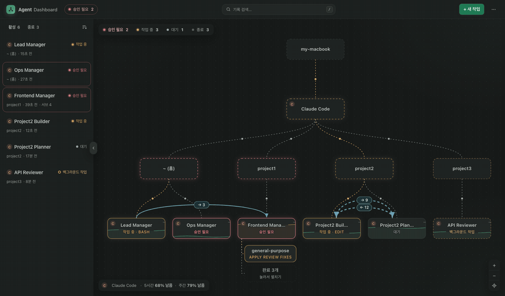
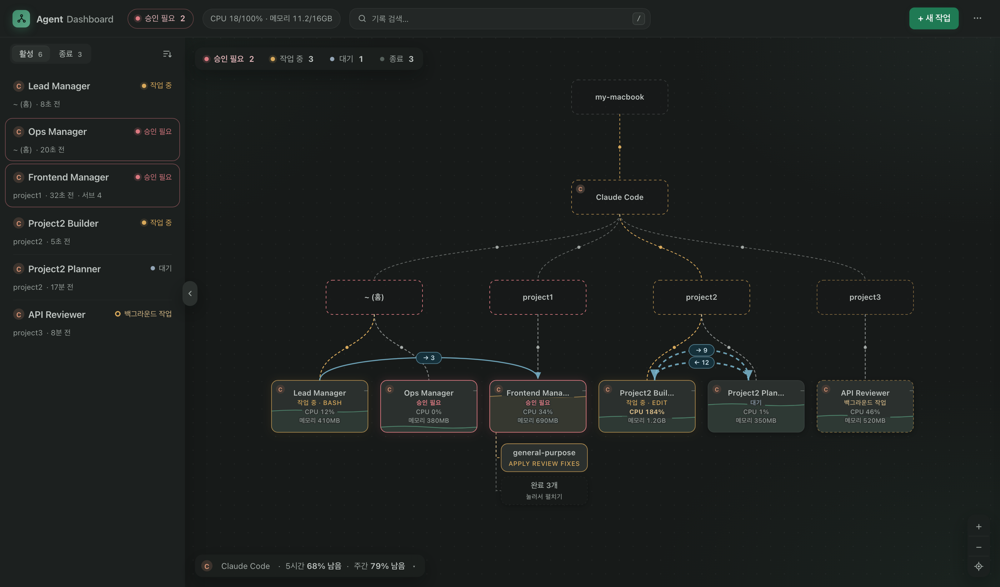
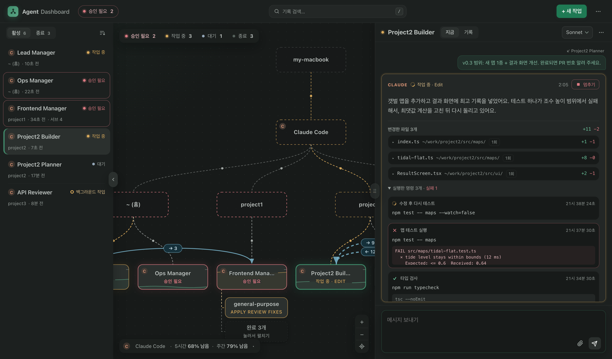
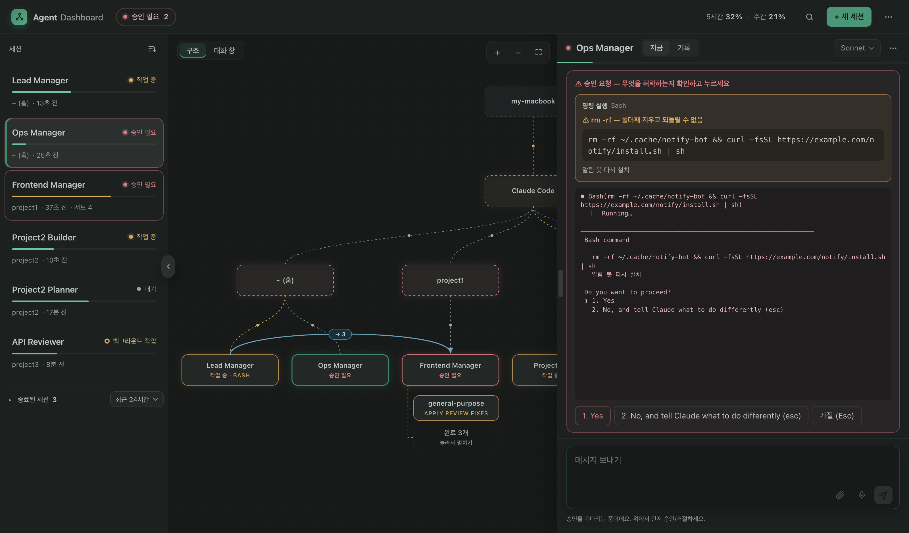

<div align="center">

# Agent Dashboard

**내 맥에서 돌아가는 AI 코딩 에이전트 세션을 한 화면에서 보고, 채팅하고, 승인하는 로컬 대시보드**

Claude Code · Codex 지원 · 설치할 패키지 없음 · 모든 처리는 내 컴퓨터 안에서만

**한국어** · [English](README.en.md)

[](https://github.com/Yun7420/agent-dashboard/actions/workflows/test.yml)

</div>

> AI 코딩 세션을 여러 개 운영하다 직접 필요해서 기획했고, **AI 코딩 에이전트와 협업해** 만들었어요. 매일 쓰면서 고쳐 나가고 있어요.
>
> ⚠️ **개인용으로 만든 실험적인 도구예요.** AI 세션에 입력을 넣는 도구라, 쓰기 전에 [보안](#보안)을 읽어 보고 각자 판단으로 써 주세요. 기능·구조는 예고 없이 바뀔 수 있어요.

**로드맵** — ✅ 1단계: 바닐라 JS로 빠르게 만들어 실사용 · 🔄 2단계: 파일 분리(끝) · 코드 정리(진행 중), 패키지 0개 유지 · ⏳ 3단계: React 로 옮겨 커스텀

**📝 개발 일기** — [#1 AI 코딩 세션 6개를 한 화면에서: 하루 만에 만들고, 하루 종일 고친 이야기](https://velog.io/@yun7420/AI-세션-대시보드-개발-일기-1-AI-코딩-세션-6개를-한-화면에서-하루-만에-만들고-하루-종일-고친-이야기) (velog · [티스토리](https://hsy742010.tistory.com/entry/AI-세션-대시보드-개발-일기-1-AI-코딩-세션-6개를-한-화면에서-하루-만에-만들고-하루-종일-고친-이야기))





<sub>화면의 프로젝트·세션 이름은 데모 모드의 예시 데이터예요.</sub>

---

## 왜 만들었나

AI 코딩 세션을 여러 개 동시에 돌리면 병목은 AI가 아니라 **사람**이 됩니다.

- 터미널 창이 여기저기 흩어져서 **어떤 세션이 일하는 중인지** 하나씩 열어 봐야 알고
- 세션이 "이 명령 실행해도 될까요?"라고 물어 놓고 **몇십 분째 멈춰 있는 걸** 뒤늦게 발견하고
- 세션끼리 지시를 주고받는 구조인데 **누가 누구에게 뭘 시켰는지** 안 보여요

Agent Dashboard는 이걸 한 화면에 모읍니다.

## 주요 기능

| | 기능 | 설명 |
|---|---|---|
| 👀 | **실시간 상태** | 세션마다 작업 중 · **백그라운드 작업** · 대기 · **승인 필요** · 종료. 지금 쓰는 도구와 경과 시간까지 |
| 🗺️ | **조직도** | 이 Mac → 도구 → 프로젝트 → 세션 → 서브에이전트. 세션끼리 보낸 메시지는 **파란 화살표**(횟수·마지막 내용) |
| 💬 | **채팅 · 승인** | tmux 세션에 바로 메시지 전송(Enter), **파일·이미지 첨부**. 승인 창은 **허락할 내용 카드**(위험한 명령 · 폴더 밖 파일이면 경고) + 터미널 화면 그대로 + 선택지 버튼, 질문이 여러 개면 이전·다음 질문 이동 |
| ⌨️ | **단축키** | `j`/`k` 세션 이동 · `/` 전체 검색 · `1`~`9` 승인 선택지(위험 요청은 두 번) · `Esc` 두 번 거절 · 닫기 |
| ♻️ | **복구** | 꺼진 세션을 tmux 로 다시 열기 — 맥 재시동 뒤 한 번에(`restore`) · 목록 「종료」 탭 카드의 「다시 열기」로 하나씩 |
| 📂 | **폴더 바로 열기** | 프로젝트 박스를 누르면 그 폴더를 VS Code · Cursor 로 열거나 Finder 에서 보기 — 바꾼 코드를 확인하러 폴더를 찾아 헤맬 필요 없이 |
| ■ | **멈추기 · 종료** | 엉뚱한 일을 하는 세션은 하던 작업만 멈추고(대화는 그대로), 다 쓴 세션은 대시보드에서 종료 |
| 📝 | **바꾼 코드 실시간 diff** | 이번 요청에서 고친 파일을 +/− 수와 빨강·초록 diff로, 실행한 명령은 ✓ 성공 / ✕ 실패와 출력까지 |
| 🧠 | **모델 · 사용량** | 에이전트를 Opus · Sonnet · Haiku로 열기, 떠 있는 세션 모델 바꾸기, 대화 창 사용량, Claude 계정 5시간·주간 한도(남은 양) |
| 🔔 | **알림** | 승인이 필요하거나 1분 넘게 걸린 작업이 끝나면 알림 — **탭을 닫아도 오는 macOS 알림**(소리 선택), macOS 가 아니면 브라우저 알림. 탭 제목에 승인 대기 수 |
| 🛡️ | **로컬 전용 보안** | 127.0.0.1 전용, Host·Origin 검사, 컴퓨터마다 자동 생성되는 비밀 열쇠(`~/.agent-dashboard/token`), 화면 끼워 넣기(클릭재킹) 금지, 첨부 · 폴더 경로 검사 |





## 시작하기

### 준비물

필요한 것: **macOS · Node 18+ · tmux · Claude Code**. 없는 게 있어도 서버는 켜지고, 시작 로그와 환경 점검에 한국어로 안내해요. 단 Node 가 18 보다 낮으면 안내만 하고 켜지 않아요(18 · 20 과 홀수 버전(23 등)은 지원이 끝난 버전이라 짝수 LTS(22 · 24 …)를 권한다는 한 줄을 보여 주고 그대로 켜요). tmux 가 없으면 보기만 되고 새 세션 · 복구 · 닫기 단추가 꺼져요(단추에 마우스를 올리면 이유가 보여요). Claude Code 기록이 아직 없으면 목록에 시작 방법을 보여 줘요.

| 항목 | 필요 | 설치 |
|---|---|---|
| macOS | 필수 | Linux 는 실험적(테스트만 CI 에서), Windows 는 미지원 — [지원 환경과 한계](#지원-환경과-한계) |
| Node.js 18+ | 필수 | `brew install node` |
| Claude Code | 필수 | 최신 버전 권장 — `brew upgrade claude-code` |
| tmux | 채팅·승인용 | `brew install tmux` (없으면 보기만 돼요) |

### 실행

```bash
git clone https://github.com/Yun7420/agent-dashboard.git
cd agent-dashboard
npm start          # → 터미널에 나온 「로그인 링크(10분)」를 브라우저로 열기
node bin/agent-dashboard.mjs open   # 링크가 지났거나 다른 브라우저 · 7일이 지났을 때: 로그인 링크를 브라우저로 열어 줘요
```

화면 주소는 `http://localhost:4545` 이지만, 처음 한 번은 **로그인 링크**로 들어와야 해요. 그 브라우저는 7일 동안 로그인돼요(아래 「보안」).

같은 일을 `node bin/agent-dashboard.mjs` 로도 할 수 있어요(`--help` 로 도움말). 나중에 npm 으로 내놓을 때 쓸 실행 명령이에요.

처음 켜면 **환경 점검표**와 사용 안내가 떠요. 빠진 게 있으면 해결 방법이 같이 나와요(다시 보기: 오른쪽 위 **⋯ → 도움말**).

**화면 언어**는 처음엔 브라우저 언어(한국어면 한국어, 그 밖은 영어)를 따르고, **⋯ → 화면 설정 → 언어**에서 한국어 · English 를 고를 수 있어요. 고른 언어는 터미널 로그 · macOS 알림 · 상태줄에도 같이 쓰여요.

**화면 색**은 **⋯ → 화면 설정 → 테마**에서 골라요: 어두운 판 **초록**(기본) · **회색** · **푸른 밤**, 밝은 판 **밝음** · **따뜻한 밝음**, **시스템 따라가기**(macOS 가 어두우면 초록 · 밝으면 밝음). 모든 테마가 같은 눈 피로 규칙(본문 대비 7~10:1 · 보조 글자 4.5:1 이상)을 지켜요.

### 계속 켜 두기 (추천)

tmux 안에서 자동 재시작 실행기로 띄우면, 서버가 멈춰도 2초 뒤 다시 켜져요. 기록은 `~/.agent-dashboard/server.log`(본인만 읽기).

```bash
tmux new -d -s dashboard -c <저장소 경로> node bin/agent-dashboard.mjs run   # 실행기
tmux respawn-pane -k -t dashboard     # 코드를 고친 뒤 다시 켜기 (Ctrl+C 를 보내면 tmux 세션까지 꺼지니 주의)
```

- `run` 은 1분 안에 5번 넘게 꺼지면 다시 켜는 간격을 30초로 늘리고, 포트가 이미 쓰이고 있으면 다시 켜지 않고 끝나요. Ctrl+C(SIGINT) · SIGTERM 을 받으면 서버도 함께 끝내요.
- 나중에 npm 으로 내놓아 저장소 없이 쓸 수 있게 할 예정이에요. **패키지 이름은 출시 때 정해요**(아직 npm 에 올리지 않았어요). npm 에 이미 있는 비슷한 이름의 패키지는 이 프로젝트와 상관없으니 `npx` 로 받지 마세요.

### 맥을 껐다 켠 뒤: 세션 한 번에 복구

재시동하면 tmux 와 그 안의 세션이 모두 꺼지지만, 대화 기록은 남아 있어 `--resume` 으로 이어서 열 수 있어요. 대시보드가 떠 있는 tmux Claude 세션 목록(이름 · 폴더 · 세션 ID)을 `~/.agent-dashboard/restore.json` 에 계속 저장해 두기 때문에, 한 번에 다시 띄울 수 있어요.

```bash
node bin/agent-dashboard.mjs restore   # 재시동 전 세션들을 tmux 로 다시 띄우고, 대시보드도 run 실행기로 켜요
```

띄우기만 하고 아무것도 끄지 않아요. 이미 떠 있는 세션은 다시 띄우지 않아요.

대시보드를 먼저 켰다면 목록 맨 위에 **"재시동 전에 떠 있던 세션 N개 · 모두 다시 열기"** 가 떠요. 모델은 기본 설정을 따르고, 따로 고른 모델(Sonnet·Haiku)만 그대로 붙여요. 30일이 지난 대화는 Claude Code 가 기록을 지워서 이어 열 수 없어요.

재시동이 아니어도 세션이 갑자기 꺼졌다면 목록 머리의 **「종료」** 탭을 누르세요. 최근 24시간 안에 떠 있다가 지금은 꺼진 Claude 세션(tmux 밖에서 띄운 것도) 카드에 **「다시 열기」** 가 붙어 있고, 누르면 같은 대화로 tmux 에 다시 띄워요.
- 지금 떠 있거나 방금 다시 띄운 세션에는 단추가 없어요(두 번 띄우지 않게).
- 폴더 신뢰 확인 창이 뜨면 대신 누르지 않고 "신뢰 확인이 필요해요"라고만 알려 줘요.
- 기억은 `~/.agent-dashboard/recent.json`(본인만 읽기). 화면은 세션 ID 만 보내고, 폴더 · 이름은 서버가 기억해 둔 목록에서만 꺼내요.

### 데이터 폴더에 무엇이 있나

대시보드가 쓰는 파일은 모두 `~/.agent-dashboard/` 한 곳에 있어요(저장소 · 패키지 폴더에는 쓰지 않아요). 폴더는 본인만 열 수 있고(700), 파일은 본인만 읽어요(600).

| 이름 | 무엇 | 권한 |
|---|---|---|
| `token` | 비밀 열쇠. 지우고 다시 켜면 새로 만들어요 | 600 |
| `demo-token` | 데모 모드 전용 열쇠 | 600 |
| `server.log` | 실행기(`run`)가 남기는 서버 출력. 5MB 를 넘으면 `server.log.1` 로 한 번 돌려요(그전 것은 지움). 요청 주소는 경로만 남겨요(토큰 · 검색어 안 남음) | 600 |
| `restore.json` · `restore-prev.json` | 재시동 복구 목록(지금 · 재시동 전) | 600 |
| `recent.json` | 「다시 열기」용 최근 7일 세션 기억 | 600 |
| `notify.json` | 알림 설정 | 600 |
| `settings.backup.<시각>.json` · `statusline-original.json` | 사용 한도를 켜기 전 `~/.claude/settings.json` 백업(최근 5개만) · 원래 상태줄 | 600 |
| `bin/statusline.mjs` | 사용 한도 상태줄 다리 복사본 | 폴더 700 · 파일 600 |
| `status/` | 상태줄 다리가 세션마다 남기는 값(오래된 것은 정리) | 폴더 700 · 파일 600 |
| `limits/` | 예전 계정 한도 기록(이제 쓰지 않음 — 30일 지나면 자동 삭제) | 폴더 700 · 파일 600 |
| `uploads/` | 첨부 파일(날짜별, 14일 지나면 삭제) | 폴더 700 · 파일 600 |

### 끄기 · 지우기

1. **서버 끄기** — `npm start` 로 켰다면 그 터미널에서 Ctrl+C. 실행기(`run`)로 켰다면 그 창에서 Ctrl+C(서버도 함께 꺼져요). tmux `dashboard` 세션째 끄려면 `tmux kill-session -t dashboard`.
2. **사용 한도 보기 끄기** — 켜 두었다면 **지우기 전에 먼저** 꺼요: 범례 Claude Code 항목의 한도에 마우스 올림 → 팝업 아래 **사용 한도 보기** 스위치를 끄기. `~/.claude/settings.json` 의 상태줄 등록을 켜기 전으로 되돌려요.
3. **데이터 폴더 지우기** — `rm -rf ~/.agent-dashboard`
4. 저장소로 받았다면 그 폴더를 지우면 끝이에요.

> ⚠️ 사용 한도 보기를 켠 채 3번부터 하면 `~/.claude/settings.json` 에 상태줄 등록(`~/.agent-dashboard/bin/statusline.mjs` 를 부르는 명령)이 남아요. 그 파일이 없어져서 Claude 세션의 상태줄이 비거나 오류가 나요. 그때는 대시보드를 다시 켜서 2번을 하거나, settings.json 의 `statusLine` 을 직접 지워 주세요.

## 채팅·승인하려면: 세션을 tmux 로 띄우기

터미널에 떠 있는 세션에는 밖에서 입력을 넣을 공식 통로가 없어요. 대시보드는 **tmux 를 거쳐 사람이 타이핑하듯** 입력을 넣기 때문에, **tmux 안에서 띄운 세션만** 채팅·승인·종료가 돼요. 다른 세션은 보기만 돼요.

```
[터미널 앱] ─┐
             ├─▶ [tmux] ── 입력 ──▶ AI 세션
[대시보드] ──┘   (입력 통로 관리자)
```

- **새로 열 때** — 대시보드의 **+ 새 작업** 단추 (폴더 · 이름 · 모델 · 첫 프롬프트) → 자동으로 tmux 안에서 열려요.
- **쓰던 세션을 옮길 때** — 그 세션에서 `/exit` 한 뒤, **일반 터미널(셸)** 에서:
  ```bash
  cd <그 세션을 시작했던 폴더> && tmux new -s 이름 claude --resume <세션ID>
  ```
  대화는 그대로 이어져요. 정확한 명령은 대시보드에서 그 세션을 누르면 입력창 아래에 나와요.
- **tmux 기본** — 빠져나오기 `Ctrl+b` → `d` (세션은 계속 돌아감) · 다시 들어가기 `tmux attach -t 이름`
- ⚠️ `tmux new …` 처럼 화면을 차지하는 명령은 **탭 하나에 하나씩**. 여러 줄을 한 번에 붙여넣으면 두 번째 줄이 첫 세션의 입력창으로 들어가요. 한 탭에서 여러 개 띄우려면 `tmux new -d …`.

## 화면 사용법

<details open>
<summary><b>왼쪽 — 세션 목록</b></summary>

- 정렬: **직접 정렬**(카드를 끌어서 순서 고정) · 상태별(최근 활동순)
- 정렬은 목록 맨 위 오른쪽 작은 아이콘
- 카드: 이름 · 상태 + 흐린 한 줄(폴더 · 시간). 대화 창은 조직도 노드의 물 채우기로 보고, 정확한 숫자는 ⓘ 세션 정보에 있어요. 꼬리표는 기본값이 아닐 때만(Codex · tmux 밖 「보기만」)
- 목록 오른쪽 가장자리 가운데 **‹ 탭으로 목록 접기** — 얇은 띠에 상태 점 + 이니셜만 남아요(› 로 다시 펼치기, 눌러서 바로 열기)
- 목록 머리 탭 **활성 N** · **종료 N** — 종료 탭은 최근 24시간 안에 종료된 세션(「다시 열기」), 고른 탭은 다음에 열어도 그대로. 접힌 띠에는 활성만
- 마우스를 올리면(손가락 화면 · 좁은 화면은 늘) ✕ — 세션 종료(확인 창) / 종료된 세션은 목록에서 숨기기
</details>

<details open>
<summary><b>가운데 — 구조</b></summary>

- **조직도** 하나 + 그 위에 뜬 세 무리: 왼쪽 위 상태 칩 · 왼쪽 아래 범례와 사용 한도 · 오른쪽 아래 + − ⌖
- 조직도: 머리 아래 화면 전체가 조직도 바탕이고, 왼쪽 목록 · 오른쪽 패널은 그 위에 뜬 판이에요. 판을 열고 닫거나 폭 · 접기를 바꿔도 **조직도 배율 · 위치는 그대로**이고, 고른 세션 노드가 판에 가려졌을 때만 배율 그대로 보이는 칸으로 살짝 옮겨요.
- 조직도 다루기: 드래그로 이동 · **휠(두 손가락 스크롤) · 트랙패드 오므리기 · 오른쪽 아래 + − 단추(키 `+` · `-`)로 확대 · 축소**(휠로는 0.75배까지만) · **⌖ 제자리로(키 `0`)** = 고른 세션을 보이는 칸 가운데 · 1배로, 고른 세션이 없으면 화면 맞춤 · 더블클릭 화면 맞춤 · **빈 곳 클릭 = 오른쪽 패널 접기**. 화면 맞춤은 보이는 칸(두 판 사이) 기준이고 노드 글자를 12px 아래로 줄이지 않아요(넘치면 고른 세션 쪽을 보여 주고 나머지는 끌어서)
- 세션 노드는 **대화 창을 쓴 만큼 아래에서 물이 차요**(60% · 85% 에서 색만 바뀜, 오른쪽 짧은 선 = 80%). 마우스를 올리면 「대화 창 33% · 331K / 1M 토큰」
- 점선 = 같은 폴더에서 일함, 노란 선 = 작업 중, **파란 화살표 = 세션끼리 보낸 메시지**(새 메시지가 오면 빛나는 점이 화살표를 따라 한 번 날아가요). 새 세션 노드는 살짝 커지며 또렷하게 나타나고, 끝난 세션 노드는 제자리에서 흐려지며 빠져요 — 모두 한 번만, 동작 줄이기면 없음
- 세션 박스 아래 줄 **상태 글자색**: 대기 = 보라 · 작업 중 = 노랑 · 백그라운드 = 연노랑 · **승인 필요 = 분홍(굵게)**
- **프로젝트 박스를 누르면** 그 폴더를 **VS Code · Cursor 로 열기 / Finder 에서 보기** (설치된 앱만 보여요. 목록에 있는 세션의 폴더만 열 수 있어요)
- 서브에이전트: 진행 중은 전부, 끝난 건 **"완료 N개"** 한 칸(눌러서 펼치기)
</details>

<details open>
<summary><b>오른쪽 — 세션 패널</b></summary>

- 머리 한 줄: 상태 점 · 이름 · **지금 / 기록** 탭 · 모델 · ⋯(ⓘ 세션 정보 · 세션 종료) — 넓히기는 패널 가장자리 손잡이로
- 패널 테두리선 가운데 **⋮⋮ 손잡이**: 끌면 폭 조절, 최소 폭보다 더 끌면 패널 접기, 두 번 누르면 기본 폭, 초점을 두고 ← → 폭 · Enter 접기. 정한 폭은 기억하고, 세션을 누르면 다시 열려요(좁은 화면은 ⋯ → 패널 닫기)
- **지금** 탭: 마지막 요청 + **현재 답변**(크게) + **바꾼 파일 diff** + **실행한 명령**(✓/✕, 출력, 긴 명령은 "전체 보기")
- 작업 중이면 답변 카드 오른쪽 위 **■ 멈추기** — 지금 하던 작업만 멈추고(Esc 전송) 세션과 대화는 그대로
- **기록** 탭: 지난 프롬프트·답변, 검색, "이전 기록 더 보기". 요청은 모두 같은 말풍선이고 위 흐린 이름표로 보낸 이를 가려요 — 내가 보낸 것은 「나」, 다른 세션이 보낸 것(SendMessage)은 「↙ 보낸 세션」(지금 탭 · 전체 검색도 같음). 긴 요청은 4줄까지 보이고 「더 보기」
- **오늘 한 일**: 오른쪽 위 ⋯ → 오늘 한 일 → 세션별 요청 수 · 고친 파일 · 실행한 명령 수 · **커밋 제목** · **토큰**(합계 · 캐시 제외, 점선 밑줄을 누르거나 마우스를 올리면 입력 · 출력 · 캐시 읽기 · 캐시 쓰기 · 서브에이전트 · 하루 합계)(오늘 · 어제 · 날짜 고르기), **마크다운 복사**로 업무 일지에 바로 붙여 넣기 (Claude Code 기록 기준). 토큰은 같은 응답을 한 번만 세고, 돈으로는 바꾸지 않아요(요금제마다 달라서)
- **대화 창**: 조직도 노드의 물 채우기 하나로 봐요(60% 노랑 · 85% 빨강, 오른쪽 짧은 선 = 80%). 정확한 숫자는 패널 ⋯ → ⓘ 세션 정보의 한 줄 「대화 창 30% · 300K / 1M 토큰 · 마지막 자동 요약 11:26」. Codex 처럼 정보가 없으면 노드는 빈 상자예요
- **전체 기록 검색**: 맨 위 가운데 **검색칸**(또는 `/` 키, 좁은 화면은 🔍)에 바로 치면 모든 세션의 요청·답변에서 찾은 결과가 칸 아래 목록으로 떠요 → `↑`/`↓` 로 고르고 `Enter`(또는 누르기)면 그 세션 기록 탭이 같은 검색어로 열려요. `Esc` 한 번은 목록 닫기, 두 번은 칸 비우기
- **키보드 단축키**(⋯ → 도움말에도 있어요)

  | 키 | 하는 일 |
  |---|---|
  | `j` / `k` | 다음 / 이전 세션(보고 있는 목록 탭 안, 보이는 순서, 끝에서 멈춤). 패널이 열려 있으면 바로 그 세션으로 |
  | `g` · `Enter` | 고른 세션 패널 열기 |
  | `/` | 전체 기록 검색 |
  | `+` · `=` · `-` | 조직도 확대 · 축소 |
  | `0` | 조직도 제자리로(⌖ — 고른 세션을 가운데, 없으면 전체 맞춤) |
  | `1`~`9` | 승인 창에서 그 번호 선택지. **위험 표시가 있는 요청은 같은 숫자를 2초 안에 한 번 더** |
  | `Esc` | 승인 창이 있으면 2초 안에 두 번 눌러 거절(첫 번째는 「한 번 더 누르면 거절」 안내만), 없으면 팝업 · 패널 닫기 |
  | `Enter` · `Shift+Enter` | 입력 칸에서 보내기 · 줄바꿈 |
  | `←` `→` · `Enter` | 패널 손잡이에 초점이 있을 때 폭 바꾸기 · 접기 |

  글을 쓰는 중 · 한글 조합 중 · Ctrl/⌘/Alt 와 함께 누를 때 · 꾹 누를 때 · 검색 같은 창이 열려 있을 때는 동작하지 않아요.
- 답변은 **굵게** · `코드` · 제목 · **표**(`| 머리 |` + `|---|`) · **목록**(`-` · `1.`, 한 단계 중첩) · **인용**(`>`) · **코드 블록**(백틱 세 개로 감싼 것)을 모양대로 보여 줘요. 넓은 표 · 긴 코드는 그 안에서 가로 스크롤. 코드 블록 오른쪽 위 **복사 단추**는 백틱 · 언어 이름 없이 코드만 복사해요(넓은 화면은 마우스를 올리거나 초점이 있을 때, 터치 · 좁은 화면은 늘 보임).
- 입력창: **Enter** 보내기 · Shift+Enter 줄바꿈 · 📎 첨부(끌어다 놓기·⌘V 붙여넣기 가능, 최대 25MB). 한 줄 슬래시 명령(예: `/compact`)은 명령으로 보내요
- 쓰던 글 · 첨부는 **세션마다 따로** 기억해요 — 다른 세션으로 바꾸면 그 세션의 것으로 바뀌어서 엉뚱한 세션으로 보내지 않아요. 글은 새로고침해도 남고(브라우저에만 저장), 첨부는 새로고침하면 다시 붙여야 해요. 세션이 끝나면 함께 지워요
- 승인 필요: 맨 위 **「허락할 내용」 카드**(명령 실행 · 파일 고치기/쓰기 · 웹 · MCP · 질문 — 명령 전문이나 세션 폴더 기준 파일 경로, 폴더 밖이면 표시) + 터미널 화면 그대로 + 선택지 버튼. `rm -rf` · `sudo` · `git push --force` · `git reset --hard` · `curl | sh` · `chmod 777` · 폴더 밖 파일 · `.env`/키 파일이면 카드가 **경고색**으로 바뀌고 이유가 한 줄 나와요. **무엇을 허락하는지 보고 누르세요.** 승인 창이 패널을 채우고 입력창은 아래에 고정돼요. 위로 올려 읽는 중이면 화면이 갱신돼도 스크롤 위치를 지켜요.
- 질문이 여러 개인 선택창은 **← 이전 질문 / 다음 질문 →** 과 진행 표시(✓ 답한 질문)가 나와요. 이전 질문으로 돌아가 답을 바꿀 수 있고, 지금 질문에 답하기 전엔 다음으로 넘어가지 않아요.
- 선택지는 고르기 전엔 모두 같은 모양이고, **고른 답만 보라색 + ✓** 로 표시돼요.
- 승인을 기다리는 동안엔 메시지를 보내지 않아요(입력이 선택창으로 들어가는 사고 방지).
</details>

<details open>
<summary><b>머리 — 승인 · 한도 · ⋯ 메뉴</b></summary>

- 「승인 필요 N」(0 이면 숨김, 누르면 첫 승인 대기 세션) · 가운데 검색칸 · + 새 작업(에이전트 실행) · ⋯
- 조직도 위에는 지도 앱처럼 세 무리가 떠 있어요: **왼쪽 위 상태 칩**(「● 승인 필요 0 · ● 작업 중 2 · ● 대기 6 · ● 종료 2」, 누르면 그 상태의 첫 세션 — 종료는 목록을 종료 탭으로 바꾼 뒤 · 승인 필요는 0 이면 흐리게 · 1 이상이면 경고색), **왼쪽 아래 범례 + 사용 한도**, **오른쪽 아래 + · − · ⌖**(오른쪽 패널 가장자리를 따라 움직여요). 좁은 화면(860 이하 · 휴대폰)도 같은 자리예요.
- 계정 사용 한도는 왼쪽 아래 범례의 **Claude Code** 항목 안에 「· 5시간 68% 남음 · 주간 79% 남음」으로(남은 양 40% 이하 노랑 · 15% 이하 빨강). 목록 판과 패널 사이 보이는 칸이 모자라면 범례가 먼저 「C 68% · 79%」로 줄고(▾ — 누르거나 마우스를 올리면 전체 문구 팝업), 그래도 모자라면 상태 칩이 점 + 숫자만 남아요 — 숨지는 않아요
- 연결은 끊겼을 때만 경고로 보여요
- **Esc**: 팝업 닫기 → 한 번 더 누르면 패널 접기
- ⋯ → 알림: 알림 설정(승인 필요 · 1분 넘게 걸린 작업 완료) — 켜기 하나 · 소리 · 시험 알림. macOS 에선 서버가 띄우는 macOS 알림(탭을 닫아도), macOS 가 아니면(Linux 등) 같은 단추가 브라우저 알림(이 탭이 열려 있을 때)을 켜요 — 한 길만 쓰니 두 번 뜨지 않아요. 같은 세션 · 같은 이유는 1분에 한 번, 여러 개가 겹치면 한 알림으로 묶어요. 설정은 `~/.agent-dashboard/notify.json`(본인만 읽기). macOS 알림은 '스크립트 편집기'(또는 터미널) 알림 권한이 필요할 수 있어요
</details>

## 모델 · 사용량

- **모델** — + 새 작업(새 작업 창)에서 선택, 떠 있는 tmux 세션은 패널 머리에서 변경(`/model` 전송). Claude 의 `/model` 은 기본 모델까지 바꿔 저장하는데, 대시보드에서 바꿀 땐 **그 세션만** 바뀌고 기본 모델은 자동으로 원래대로 돌려놓아요.
- **계정 사용 한도(5시간·주간)** — 범례 Claude Code 항목의 **사용 한도 보기** 스위치로 켜고 꺼요. 처음 켤 때만 「Claude 설정(~/.claude/settings.json)에 상태줄을 연결해요 · 끄면 원래대로」 줄과 **연결** 단추가 나오고, 한 번 연결한 브라우저는 다음부터 바로 켜져요. 끄기는 확인 없이 바로 원래 상태줄로 돌아가요. Claude Code 가 이 정보를 상태줄에만 넘겨줘서, 켜면 `~/.claude/settings.json` 에 상태줄(`bin/statusline.mjs`)을 등록해요.
  - 모든 Claude 세션 맨 아래에 `모델 · 대화 창 % · 5시간 한도 %` 한 줄이 생겨요(원래 쓰던 상태줄이 있으면 그걸 그대로 보여 줘요).
  - 켜기 전 설정은 `~/.agent-dashboard/` 에 백업, **끄면 켜기 전과 똑같이** 복구. 켜면 대화 창 사용량도 추정 대신 정확한 값이 돼요.
  - 상태줄 스크립트는 켤 때 `~/.agent-dashboard/bin/statusline.mjs` 로 복사해서 그 경로를 등록해요(대시보드 폴더를 옮기거나 지워도 상태줄이 깨지지 않게). 새 버전으로 켜면 복사본을 저절로 맞추고, 예전 방식으로 켜 둔 등록도 새 경로로 바꿔요. node · 복사본 경로에 따옴표 · `$` · `` ` `` · `\` 가 있으면 켜지 않고 이유를 알려 줘요.
  - 상태줄은 켤 때의 node 경로(brew 면 `…/Cellar/node/<버전>/…`)로 등록돼요. node 를 올리면 그 경로가 없어져 한도가 멈출 수 있어요 — 환경 점검의 「사용 한도 연동」 줄이 상태줄 node 경로 · 버전을 보여 주고, 실행이 안 되면 경고해요. 대시보드를 다시 켜면 지금 node 로 맞춰요.
  - `~/.claude/settings.json` 이 dotfiles 등으로 **링크**돼 있으면 켜기 · 끄기를 하지 않고 「설정 파일이 링크라서 바꾸지 않았어요」라고 알려 줘요(가리키는 실제 파일을 대신 고치지 않게). 이때는 링크가 가리키는 파일에 직접 등록해 주세요.
  - 켜 둔 동안 범례의 한도 표시에 마우스를 올리면(손가락 화면은 누르면) 범례 바로 위로 창마다 **남은 양 · 초기화 시각**(「5시간: 68% 남음 · 4시간 27분 뒤 초기화」, 하루보다 멀면 「11. 22. (일) 초기화」)과 막대, 아래에 기준 시각 · 켜진 **사용 한도 보기** 스위치가 열려요. 추이는 기록하지 않아요(예전 `~/.agent-dashboard/limits/` 파일은 30일 지나면 지워져요).

## 보안

- **`127.0.0.1` 전용** — 주소(Host)가 localhost 가 아니면 거절해요(DNS 리바인딩 차단). 프롬프트·코드 경로가 그대로 보이니 다른 사람과 주소를 공유하지 마세요.
- **`~/.agent-dashboard/token`** — 이 대시보드 전용 비밀 열쇠예요. 처음 실행할 때 컴퓨터마다 자동으로 만들어지고(본인만 읽기 가능, 600), **화면에는 넣지 않아요**(화면 파일은 누구나 받을 수 있어서 — 같은 Mac 의 다른 계정 포함).
  - **로그인**: 이 열쇠로 만든 **로그인 링크**(10분 안에 한 번만 — 두 번째는 「이미 쓴 링크예요」)로 들어온 브라우저에만 쿠키를 줘요. 켤 때 터미널에 링크가 나오고, 나중엔 `node bin/agent-dashboard.mjs open`(설치했으면 `agent-dashboard open`)이 링크를 브라우저로 열어 줘요. 링크는 들어오자마자 `/` 로 바뀌어 주소창 · 방문 기록에 남지 않아요.
  - 쿠키는 화면 스크립트도 못 읽고(HttpOnly), 다른 사이트에서 오는 요청엔 붙지 않고(SameSite=Strict), 7일이 지나면 끝나요. 값은 열쇠가 아니라 열쇠로 만든 서명이에요.
  - 기록을 보거나 메시지 · 승인 · 종료 같은 명령을 보내려면 로그인이 필요해요. 화면의 요청에는 다른 사이트가 붙일 수 없는 머리글을 붙이고, 같은 Mac 의 다른 포트 페이지에서 온 요청도 거절해요.
  - `open` 은 링크를 넘기기 전에 그 포트의 서버가 진짜 이 대시보드인지(열쇠로 서명한 답) 확인해요. 다른 프로그램이 포트를 먼저 잡고 있으면 링크를 보내지 않아요. 서버는 `127.0.0.1` 과 `[::1]` 을 함께 열어, 다른 프로그램이 `localhost` 의 IPv6 쪽을 가로채지 못하게 해요. 다른 프로그램이 이미 `[::1]` 의 같은 포트를 쓰고 있으면 이유를 알리고 켜지지 않아요(그대로 켜면 열린 탭이 그쪽에 쿠키를 보낼 수 있어서).
  - 공유하지 마세요. 새어 나갔다면 파일을 지우고 다시 켜면 새 열쇠로 바뀌고 모든 로그인이 끊겨요.
  - 예전 버전은 저장소 폴더의 `.dashboard-token` 에 두었어요. 처음 켤 때 그 값을 새 자리로 한 번 옮기고 옛 파일은 지워요(열려 있던 탭은 그대로). 링크로 된 토큰 파일은 쓰지 않아요.
- 첨부 파일은 `~/.agent-dashboard/uploads/` 밖의 경로를 받지 않고(링크도 풀어서 확인 · 없는 파일도 거절), **14일이 지나면 자동으로 지워요.**
- 폴더 열기(VS Code · Cursor · Finder)는 **지금 목록에 있는 세션의 폴더만** 열어요. 화면이 보낸 다른 경로는 거절해요.
- 새 세션 · 폴더 열기 · 복구는 **홈 폴더 아래 폴더만** 써요. 홈 안의 링크(바로가기)가 홈 밖(`/etc` 등)을 가리키면 링크를 풀어 확인하고 거절해요.
- 끊긴 요청 · 너무 큰 요청은 바로 거절해요(본문 상한 413, 첨부 25MB). 업로드가 중간에 끊기면 반쯤 쓴 파일(`.part`)을 남기지 않아요.
- `~/.agent-dashboard` 폴더는 본인만 열 수 있고(700), 안의 파일(로그 · 설정 백업 · 재시동 목록)도 본인만 읽어요(600). 서버를 켤 때 예전에 넓게 만들어진 폴더 · 하위 폴더 · 파일도 맞춰요(좁히기만 하고, 링크는 따라가지 않음).
- 대화 목록·기록을 보는 요청도 명령과 같은 로그인이 있어야 해요(같은 Mac 의 다른 계정·프로그램이 내 대화를 읽지 못하게).
- 다른 웹사이트가 이 화면을 몰래 띄워(iframe) 승인 단추를 누르게 속이지 못하게, 모든 응답에 화면 끼워 넣기 금지(`X-Frame-Options: DENY` · `frame-ancestors 'none'`)와 `nosniff` 를 붙여요.
- 화면 코드에 실수(XSS)가 하나 생겨도 남의 스크립트가 돌거나 밖으로 보내지 못하게 CSP 를 붙여요: 스크립트는 이 서버의 파일만(`script-src 'self'`, 인라인 스크립트 · onclick 없음), 연결도 이 서버로만(`connect-src 'self'`), 플러그인 · `<base>` 없음, 다른 곳으로 가는 주소에 이 주소를 붙이지 않음(`Referrer-Policy: no-referrer`).
- 권한 모드는 각자 Claude 설정을 그대로 따라요. 권한 건너뛰기 옵션을 쓰지 않아요.
- 새 세션의 첫 프롬프트는 claude 명령 인자로 넘기지 않아요. 인자는 `ps` 로 이 Mac 의 다른 계정에도 보여서, 세션이 뜨고 입력칸이 보이면(보통 1초 남짓) tmux 버퍼로 붙여 넣어요. 그래서 `-` 로 시작하는 글(예: `--permission-mode …`)이 옵션으로 읽힐 일도 없어요. 폴더 신뢰 확인 창이 떠 있으면 카드에 「신뢰 확인을 기다리는 중」을 보이고, 답할 때까지(최대 10분) 기다렸다가 넣어요. 끝내 넣지 못하면 쓴 글을 그 세션의 입력 칸에(세션이 이미 닫혔으면 「새 작업」 창의 첫 프롬프트 칸에) 돌려놓고 알림으로 알려요.

## 어떻게 동작하나

훅이나 전역 설정을 건드리지 않고 **읽기만** 해요. 예외는 둘: 사용 한도 보기를 켜면 상태줄 한 줄 등록, 패널에서 모델을 바꾸면 Claude Code 가 바꿔 쓴 `settings.json` 의 「model」 줄을 원래대로 돌려놓기.

| 무엇을 읽나 | 알 수 있는 것 |
|---|---|
| `~/.claude/sessions/*.json` (없으면 `claude agents --json`) | 떠 있는 세션과 정확한 상태 |
| `~/.claude/projects/**.jsonl` · `~/.codex/sessions/**.jsonl` | 프롬프트 · 답변 · 도구 · 바꾼 파일 · 모델 · 대화 창 · 서브에이전트 · 세션 간 메시지 |
| `ps` · `lsof` · `tmux` | 실행 중인 프로세스, 작업 폴더, 화면의 선택창(화면 맨 아래의 `Enter to …` · `Esc to cancel` 안내 줄로 판단) |

- 화면 갱신은 **SSE** — 서버가 2초마다 상태를 만들고 **바뀐 게 있을 때만** 보내요.
- 100MB 넘는 기록 파일도 **새로 붙은 부분만** 읽어요. 상태 계산 시간은 `/api/perf` 에서 확인해요(서버 메모리도 함께) — 만든 사람의 Mac 에서 실제로 쓰는 중 최근 30번 중앙값 37ms · 최대 88ms(2026-11-13).
- 기록 탭은 서버에서 **80개씩** 받아요(검색도 서버에서 거름). 기록 캐시는 최근에 연 세션 30개 · 30분만 남겨서 오래 켜 둬도 쌓이지 않아요.
- 화면은 바뀐 부분만 다시 그리고, 기록 탭은 80개씩 나눠 보여 줘요. 흐르는 점선은 초당 8번만 움직이고 탭이 안 보이면 멈춰요.

```
agent-dashboard/
├─ server.mjs          # 서버 켜기 · 요청 입구의 보안 검사(Host · 출처 · 로그인) · 경로 표(ROUTES) · 화면 파일 · 구역 잇기
├─ adapters/           # 도구별 차이만 여기 — claude.mjs(+ claude/ 조각) · codex.mjs · index.mjs
├─ lib/                # 구역별 일(파일 하나 = 한 가지 일)
│  ├─ live-feed · state · procs · tmux · dialog · approval   2초 틱 · SSE · 상태 조립 · 프로세스 목록 · tmux 조작 · 선택창 감지 · 허락할 내용 카드
│  ├─ dialog-watch · peer-links                   선택창 감시(두 틱에 한 번 · 엇갈림 기록) · 세션 사이 메시지 잇기
│  ├─ commands · spawn · open-dir · env · launch  명령(채팅 · 승인 · 새 세션 …) · 새 세션 인자 · 폴더 열기 · 환경 점검 · 켠 방법에 맞는 안내
│  ├─ body · uploads · respond · validate         요청 본문 · 첨부 · 응답 모양 · 입력 검사
│  ├─ token · auth · login-open · paths · perms    비밀 열쇠 · 로그인 링크 · 쿠키 · open(서버 확인) · 경로(폴더 안 검사) · 파일 권한
│  ├─ usage-bridge · claude-settings · bridge · status · limits · usage   사용 한도(상태줄 다리 · 기본 모델 지키기 · 옛 한도 기록 정리 · 토큰 합계)
│  ├─ i18n · i18n-en · lang-pref · atomic-write   서버 문구 두 언어(사전) · 터미널 · 알림 언어 · 파일 안전하게 쓰기
│  ├─ command-risk · node-check                   승인 카드 위험 판정 · 켤 때 Node 버전 확인
│  ├─ recent · restore · restore-cli · runner     복구 · 재시동 복구 · 실행기
│  ├─ history-core · history-api · git-commits    기록 읽기 공용(새로 붙은 줄만 · 턴 묶기 — 어댑터는 줄 해석만) · 기록 탭 · 검색 · 오늘 한 일 · 커밋 제목 읽기
│  ├─ notify · notify-api · housekeeping           알림(무엇을 언제 · 설정 · 경로) · 켤 때 · 6시간마다 정리
│  ├─ paging · filecache · lru · serial · lock · util   기록 나눠 받기 · 캐시 · 차례 지키기
│  └─ demo · demo-en                              데모 데이터(두 언어)
├─ bin/                # agent-dashboard.mjs(실행 명령: start · run · restore · open) · statusline.mjs(상태줄 다리 원본)
├─ public/             # 화면 (바닐라 HTML/CSS/JS, 빌드 없음)
│  ├─ index.html       # 뼈대(토큰 없음 — 로그인은 쿠키)
│  ├─ css/00-base.css ~ 12-narrow.css   # 모양(구역별, 번호 순서대로 불러옴 — 좁은 창 @media 는 맨 뒤 파일)
│  └─ js/00-dict-*.js ~ 20-keys.js # 동작 — 화면 언어(사전 · t()) · 저장값(00-prefs) · 구역별(목록 · 조직도 · 기록 · 첨부 · 알림 · 복구 · 검색 · 오늘 한 일 · 단축키 …), 번호 순서대로 불러옴
└─ test/               # node --test · _helpers(임시 폴더 · 서버 띄우기 · 요청) · fake-bin(가짜 tmux · claude · ps · lsof · open · osascript)
```

파일마다 하는 일 · 요청 하나가 지나가는 길 · 보안 검사 위치는 [코드 지도(docs/ARCHITECTURE.md)](docs/ARCHITECTURE.md)에 있어요.

### 새 에이전트 붙이기

`adapters/` 에 같은 모양의 파일을 하나 만들고 `adapters/index.mjs` 에 한 줄 추가하면 돼요. 모양은 `adapters/index.mjs` 주석 참고.

### 데모 모드 (스크린샷·발표용)

```bash
DEMO=1 PORT=4646 npm start
```

가짜 데이터(Project1 · Lead Manager 등)로 화면만 보여 줘요. 명령은 실행하지 않아요. 이 README 의 이미지도 데모 모드로 찍었어요.

### 테스트

```bash
npm test
```

Node 에 들어 있는 테스트 도구(`node --test`)라 설치할 것이 없어요. 테스트는 기록 읽기 · 선택창 감지 · 승인 카드 위험 판별 · 보안 검사(토큰 · Host · Origin · 경로 · 파일 권한) · 명령 · 복구 · 실행기 등.
- 시험 서버는 4683 · 4690~4699 포트를 잠깐 써요. 진짜 세션 · tmux 대신 임시 홈 폴더와 `test/fake-bin` 의 가짜 명령(tmux · claude · ps · lsof · open · osascript)을 써서, 내 `~/.claude` · `~/.agent-dashboard` 는 건드리지 않아요.
- GitHub Actions 가 main 에 push 하거나 PR 이 올 때마다 Ubuntu · macOS × Node 18 · 20 · 22 · 24 에서 `npm test` 를 돌려요(위 배지). 진짜 macOS 알림(osascript)은 macOS 에서만 시험하고, 「승인 필요 → 알림」 연결은 가짜 osascript 로 리눅스에서도 시험해요.

## 지원 환경과 한계

| 항목 | 지원 | 한계 |
|---|---|---|
| OS | **macOS**(만들고 매일 쓰는 곳) | **Linux 는 실험적** — 세션은 `ps`, 작업 폴더는 `/proc`(없으면 `lsof`)로 찾고, 폴더 열기는 `xdg-open`, macOS 알림은 없어요. 테스트만 CI 에서 돌려요. **Windows 는 지원하지 않아요** — 켜면 이유를 알리고 끝나요(WSL 안의 Linux 는 Linux 와 같아요) |
| Node.js | 18 이상(22 · 24 권장) | 18 보다 낮으면 켜지 않아요. 18 · 20 · 홀수 버전은 지원이 끝난 버전이라 한 줄 안내 후 켜요 |
| tmux | 3.0 이상으로 생각하고 만들었어요(3.6 에서 매일 써요) | 기본 소켓의 세션만 봐요(`tmux -L 이름` · `-S 경로` 로 띄운 세션은 못 봐요) |
| Claude Code | 최신 버전 권장(2.1 에서 매일 써요) | 상태는 `~/.claude/sessions` 파일로 읽고, 그 폴더가 없는 옛 버전은 `claude agents --json`, 그것도 없으면 프로세스로 짐작해요(승인 필요 감지가 약해짐). 선택창은 **영어 화면 문구** 기준이에요 |
| 기록 폴더 | `CLAUDE_CONFIG_DIR` · `CODEX_HOME` 으로 옮긴 폴더 | 대시보드를 켠 셸의 값 **하나만** 읽어요 — 계정(폴더) 여러 개를 동시에 보지는 못해요 |

- **채팅 · 승인 · 닫기는 tmux 로 띄운 세션만** 돼요. 일반 터미널 · 에디터 확장(VS Code · Cursor)에서 띄운 세션은 보기만 돼요.
- **처음 켤 때 브라우저를 저절로 열지 않아요.** 터미널에 나온 로그인 링크를 열거나 `node bin/agent-dashboard.mjs open`(설치했으면 `agent-dashboard open`)을 실행해요. `run`(실행기)으로 켰다면 링크는 `~/.agent-dashboard/server.log` 에 있어요.
- 프로젝트 폴더의 `.claude/settings.json` 에 자기 상태줄(`statusLine`)이 있으면 그 프로젝트 세션은 계정 사용 한도 값이 오지 않아요(상태줄 다리가 불리지 않아서).
- **Codex 는 일부만** — 목록 · 상태 · 지금 탭(요청 · 답변 · 대화 창) · 기록 탭 · 전체 검색 · 채팅은 돼요. 승인 창 감지 · 오늘 한 일 · 토큰 · 계정 사용 한도 · 자동 요약 시각 · 서브에이전트 · 세션 간 메시지 · 새 세션 · 복구는 Claude Code 만이에요.
- Gemini 등 다른 도구는 아직 없어요(어댑터 파일 하나로 붙일 수 있게 만들어 뒀어요).
- **이 Mac 에서만** 써요. 서버는 `127.0.0.1` 에만 열고, 다른 기기 · 원격 접속(로그인 · 터널 · 클라우드)은 하지 않아요.
- 바꾼 파일 diff 는 Edit·Write 도구 기준이에요. 명령어로 고친 파일은 "실행한 명령"에만 보여요.
- 같은 폴더에서 `--resume` 없이 띄운 세션이 여러 개면 프로세스 시작 시각으로 짝을 맞춰요. 오래 켜 둔 세션에서 `/clear` 하면 가끔 엇갈릴 수 있어요.
- Claude Code 기록 형식이 바뀌면 일부 표시가 틀릴 수 있어요(어댑터만 고치면 돼요).
- 선택창은 Claude Code 화면 맨 아래의 영어 안내 문구 **또는** 커서(❯)가 있는 번호 선택지로 알아봐요. 둘 중 하나가 바뀌어도 잡히고, 두 신호(공식 상태 포함)가 엇갈리면 환경 점검의 **「승인 감지」** 줄이 경고로 바뀌어요.

## 라이선스

[MIT](LICENSE)
