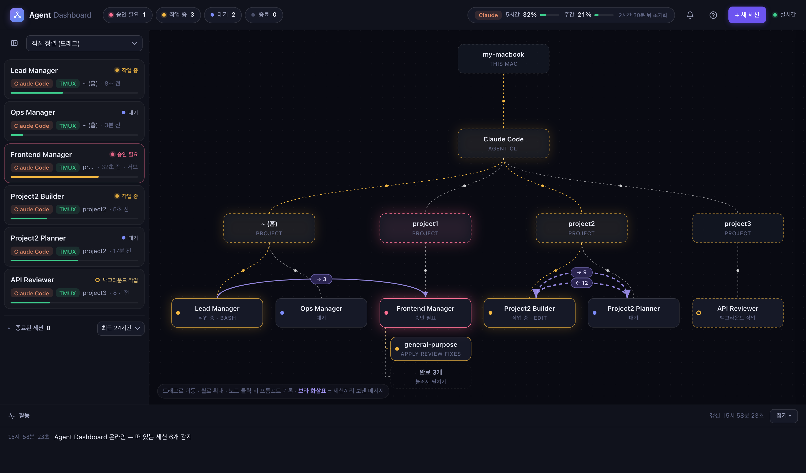
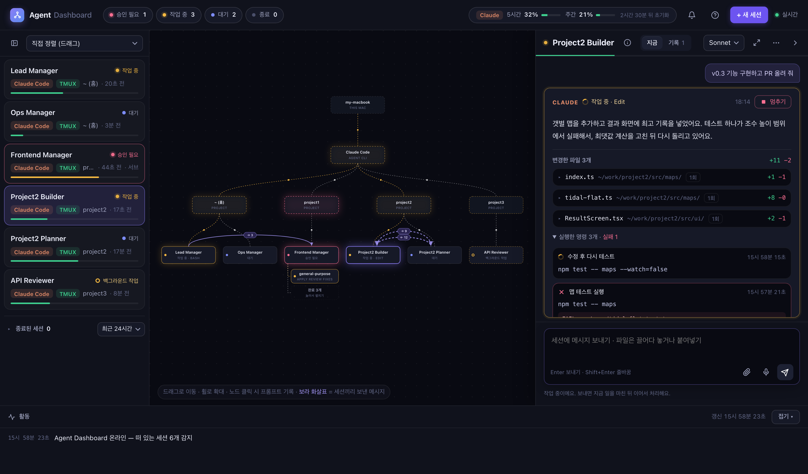
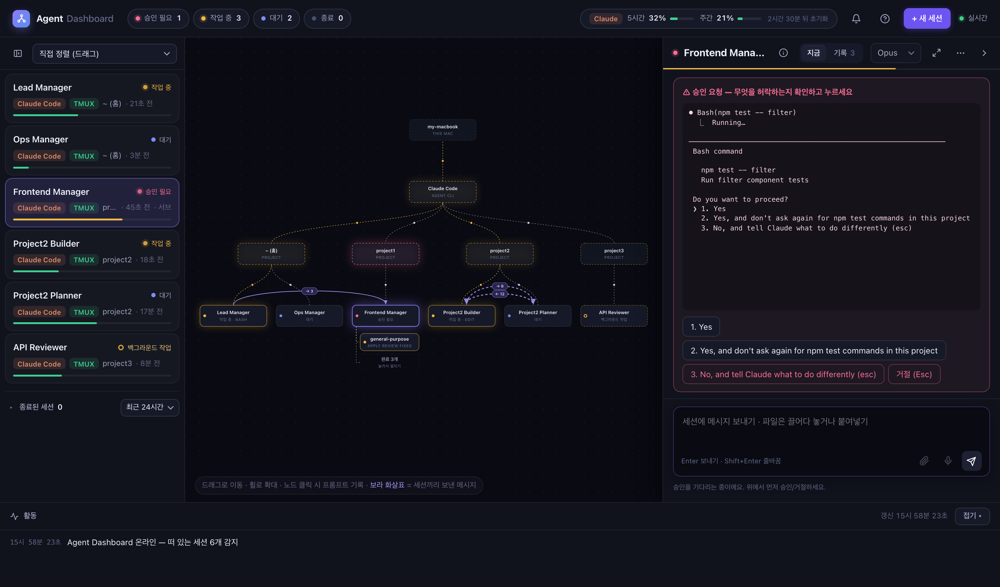

<div align="center">

# Agent Dashboard

**내 맥에서 돌아가는 AI 코딩 에이전트 세션을 한 화면에서 보고, 채팅하고, 승인하는 로컬 대시보드**

Claude Code · Codex 지원 · 설치할 패키지 없음 · 모든 처리는 내 컴퓨터 안에서만

</div>

> AI 코딩 세션을 여러 개 운영하다 직접 필요해서 기획했고, **AI 코딩 에이전트와 협업해** 만들었어요. 매일 쓰면서 고쳐 나가고 있어요.

**로드맵** — ✅ 1단계: 바닐라 JS로 빠르게 만들어 실사용 · ⏳ 2단계: 파일 분리·코드 정리(패키지 0개 유지) · ⏳ 3단계: React 로 옮겨 커스텀



<sub>화면의 프로젝트·세션 이름은 데모 모드의 예시 데이터예요.</sub>

---

## 왜 만들었나

AI 코딩 세션을 여러 개 동시에 돌리면 병목은 AI가 아니라 **사람**이 됩니다.

- 터미널 창이 여기저기 흩어져서 **어떤 세션이 일하는 중인지** 하나씩 열어 봐야 알고
- 세션이 "이 명령 실행해도 될까요?"라고 물어 놓고 **몇십 분째 멈춰 있는 걸** 뒤늦게 발견하고
- 세션끼리 지시를 주고받는 구조인데 **누가 누구에게 뭘 시켰는지** 안 보여요

Agent Dashboard는 이걸 한 화면에 모읍니다.

## 주요 기능

| | 기능 | 설명 |
|---|---|---|
| 👀 | **실시간 상태** | 세션마다 작업 중 · **백그라운드 작업** · 대기 · **승인 필요** · 종료. 지금 쓰는 도구와 경과 시간까지 |
| 🗺️ | **조직도** | 이 Mac → 도구 → 프로젝트 → 세션 → 서브에이전트. 세션끼리 보낸 메시지는 **보라 화살표**(횟수·마지막 내용) |
| 💬 | **채팅 · 승인** | tmux 세션에 바로 메시지 전송(Enter), 음성 입력, **파일·이미지 첨부**. 승인 창은 터미널 화면 그대로 + 선택지 버튼, 질문이 여러 개면 이전·다음 질문 이동 |
| ■ | **멈추기 · 종료** | 엉뚱한 일을 하는 세션은 하던 작업만 멈추고(대화는 그대로), 다 쓴 세션은 대시보드에서 종료 |
| 📝 | **바꾼 코드 실시간 diff** | 이번 요청에서 고친 파일을 +/− 수와 빨강·초록 diff로, 실행한 명령은 ✓ 성공 / ✕ 실패와 출력까지 |
| 🧠 | **모델 · 사용량** | 새 세션을 Opus · Sonnet · Haiku로 열기, 떠 있는 세션 모델 바꾸기, 대화 창 사용량, Claude 계정 5시간·주간 한도 |
| 🔔 | **알림** | 승인이 필요하거나 1분 넘게 걸린 작업이 끝나면 맥 알림. 탭 제목에 승인 대기 수 |
| 🛡️ | **로컬 전용 보안** | 127.0.0.1 전용, Host·Origin 검사, 컴퓨터마다 자동 생성되는 비밀 열쇠 |





## 시작하기

### 준비물

| 항목 | 필요 | 설치 |
|---|---|---|
| macOS | 필수 | Linux 는 대부분 동작, Windows 는 미지원 |
| Node.js 18+ | 필수 | `brew install node` |
| Claude Code | 필수 | 최신 버전 권장 — `brew upgrade claude-code` |
| tmux | 채팅·승인용 | `brew install tmux` (없으면 보기만 돼요) |

### 실행

```bash
git clone https://github.com/Yun7420/agent-dashboard.git
cd agent-dashboard
npm start          # → 브라우저에서 http://localhost:4545
```

처음 켜면 **환경 점검표**와 사용 안내가 떠요. 빠진 게 있으면 해결 방법이 같이 나와요(다시 보기: 오른쪽 위 **?**).

### 계속 켜 두기 (추천)

tmux 안에서 자동 재시작 실행기로 띄우면, 서버가 멈춰도 2초 뒤 다시 켜져요. 기록은 `~/.agent-dashboard/server.log`.

```bash
tmux new -d -s dashboard -c <저장소 경로> ./bin/run.sh
tmux respawn-pane -k -t dashboard     # 코드를 고친 뒤 다시 켜기 (Ctrl+C 를 보내면 tmux 세션까지 꺼지니 주의)
```

## 채팅·승인하려면: 세션을 tmux 로 띄우기

터미널에 떠 있는 세션에는 밖에서 입력을 넣을 공식 통로가 없어요. 대시보드는 **tmux 를 거쳐 사람이 타이핑하듯** 입력을 넣기 때문에, **tmux 안에서 띄운 세션만** 채팅·승인·종료가 돼요. 다른 세션은 보기만 돼요.

```
[터미널 앱] ─┐
             ├─▶ [tmux] ── 입력 ──▶ AI 세션
[대시보드] ──┘   (입력 통로 관리자)
```

- **새로 열 때** — 대시보드의 **+ 새 세션** (폴더 · 이름 · 모델 · 첫 프롬프트) → 자동으로 tmux 안에서 열려요.
- **쓰던 세션을 옮길 때** — 그 세션에서 `/exit` 한 뒤, **일반 터미널(셸)** 에서:
  ```bash
  cd <그 세션을 시작했던 폴더> && tmux new -s 이름 claude --resume <세션ID>
  ```
  대화는 그대로 이어져요. 정확한 명령은 대시보드에서 그 세션을 누르면 입력창 아래에 나와요.
- **tmux 기본** — 빠져나오기 `Ctrl+b` → `d` (세션은 계속 돌아감) · 다시 들어가기 `tmux attach -t 이름`
- ⚠️ `tmux new …` 처럼 화면을 차지하는 명령은 **탭 하나에 하나씩**. 여러 줄을 한 번에 붙여넣으면 두 번째 줄이 첫 세션의 입력창으로 들어가요. 한 탭에서 여러 개 띄우려면 `tmux new -d …`.

## 화면 사용법

<details open>
<summary><b>왼쪽 — 세션 목록</b></summary>

- 정렬: **직접 정렬**(카드를 끌어서 순서 고정) · 상태별 · 이름순
- 카드 아래 막대 = 대화 창 사용량(초록 → 노랑 → 빨강)
- 맨 위 아이콘으로 **목록 접기** — 얇은 띠에 상태 점 + 이니셜만 남아요(눌러서 바로 열기)
- 떠 있는 세션 아래 구분선의 **종료된 세션 N** 을 누르면 펼쳐지고, 옆 선택 상자로 기간(6시간·24시간·3일·7일)을 골라요
- 마우스를 올리면 ✕ — 세션 종료(확인 창) / 종료된 세션은 목록에서 숨기기
</details>

<details open>
<summary><b>가운데 — 조직도</b></summary>

- 드래그 이동 · 휠 확대 · 더블클릭 화면 맞춤 · **빈 곳 클릭 = 오른쪽 패널 접기**
- 점선 = 같은 폴더에서 일함, 노란 선 = 작업 중, **보라 화살표 = 세션끼리 보낸 메시지**
- 서브에이전트: 실행 중은 전부, 최근 10분 안에 끝난 건 5개까지, 나머지는 **"완료 N개"** 한 칸(눌러서 펼치기)
</details>

<details open>
<summary><b>오른쪽 — 세션 패널</b></summary>

- 머리 한 줄: 상태 점 · 이름 · ⓘ 세부 정보(경로·PID·세션 ID…) · **지금 / 기록** 탭 · 모델 · ⤢ 넓게 · ⋯(세션 종료) · › 접기
- 왼쪽 가장자리를 끌어 **폭 조절**(더블클릭 = 기본 폭), 정한 폭은 기억
- **지금** 탭: 마지막 요청 + **현재 답변**(크게) + **바꾼 파일 diff** + **실행한 명령**(✓/✕, 출력, 긴 명령은 "전체 보기")
- 작업 중이면 답변 카드 오른쪽 위 **■ 멈추기** — 지금 하던 작업만 멈추고(Esc 전송) 세션과 대화는 그대로
- **기록** 탭: 지난 프롬프트·답변, 검색, "이전 기록 더 보기"
- 입력창: **Enter** 보내기 · Shift+Enter 줄바꿈 · 🎤 음성 입력 · 📎 첨부(끌어다 놓기·⌘V 붙여넣기 가능, 최대 25MB)
- 승인 필요: 터미널 화면 그대로 + 선택지 버튼. **무엇을 허락하는지 보고 누르세요.** 승인 창이 패널을 채우고 입력창은 아래에 고정돼요. 위로 올려 읽는 중이면 화면이 갱신돼도 스크롤 위치를 지켜요.
- 질문이 여러 개인 선택창은 **← 이전 질문 / 다음 질문 →** 과 진행 표시(✓ 답한 질문)가 나와요. 이전 질문으로 돌아가 답을 바꿀 수 있고, 지금 질문에 답하기 전엔 다음으로 넘어가지 않아요.
- 선택지는 고르기 전엔 모두 같은 모양이고, **고른 답만 보라색 + ✓** 로 표시돼요.
- 승인을 기다리는 동안엔 메시지를 보내지 않아요(입력이 선택창으로 들어가는 사고 방지).
</details>

<details open>
<summary><b>아래 — 활동 · 키보드</b></summary>

- 활동: 대시보드를 켠 뒤 일어난 변화(상태 · 새 프롬프트 · 세션 간 메시지 · 서브에이전트). 오른쪽 **접기** 버튼으로 한 줄로
- **Esc**: 팝업 닫기 → 한 번 더 누르면 패널 접기
- 🔔: 알림 켜기(승인 필요 · 1분 넘게 걸린 작업 완료)
</details>

## 모델 · 사용량

- **모델** — + 새 세션에서 선택, 떠 있는 tmux 세션은 패널 머리에서 변경(`/model` 전송). Claude 의 `/model` 은 기본 모델까지 바꿔 저장하는데, 대시보드에서 바꿀 땐 **그 세션만** 바뀌고 기본 모델은 자동으로 원래대로 돌려놓아요.
- **계정 사용 한도(5시간·주간)** — 헤더의 **사용 한도 보기**로 켜요. Claude Code 가 이 정보를 상태줄에만 넘겨줘서, 켜면 `~/.claude/settings.json` 에 상태줄(`bin/statusline.mjs`)을 등록해요.
  - 모든 Claude 세션 맨 아래에 `모델 · 대화 창 % · 5시간 한도 %` 한 줄이 생겨요(원래 쓰던 상태줄이 있으면 그걸 그대로 보여 줘요).
  - 켜기 전 설정은 `~/.agent-dashboard/` 에 백업, **끄면 켜기 전과 똑같이** 복구. 켜면 대화 창 사용량도 추정 대신 정확한 값이 돼요.

## 보안

- **`127.0.0.1` 전용** — 주소(Host)가 localhost 가 아니면 거절해요(DNS 리바인딩 차단). 프롬프트·코드 경로가 그대로 보이니 다른 사람과 주소를 공유하지 마세요.
- **`.dashboard-token`** — 이 대시보드 전용 비밀 열쇠예요. 처음 실행할 때 컴퓨터마다 자동으로 만들어지고(본인만 읽기 가능), 메시지·승인·종료 같은 **명령은 이 열쇠가 맞을 때만** 받아요. 브라우저에선 아무 웹사이트나 localhost 로 요청을 보낼 수 있어서, 악성 사이트가 몰래 명령을 넣는 걸 막는 용도예요.
  - 공유·커밋하지 마세요(`.gitignore` 처리됨). 새어 나갔다면 파일을 지우고 다시 켜면 새 열쇠로 바뀌어요.
- 첨부 파일은 `~/.agent-dashboard/uploads/` 밖의 경로를 받지 않아요.
- 권한 모드는 각자 Claude 설정을 그대로 따라요. 권한 건너뛰기 옵션을 쓰지 않아요.

## 어떻게 동작하나

훅이나 전역 설정을 건드리지 않고 **읽기만** 해요(사용 한도 보기를 켠 경우만 상태줄 한 줄 등록).

| 무엇을 읽나 | 알 수 있는 것 |
|---|---|
| `~/.claude/sessions/*.json` (없으면 `claude agents --json`) | 떠 있는 세션과 정확한 상태 |
| `~/.claude/projects/**.jsonl` · `~/.codex/sessions/**.jsonl` | 프롬프트 · 답변 · 도구 · 바꾼 파일 · 모델 · 대화 창 · 서브에이전트 · 세션 간 메시지 |
| `ps` · `lsof` · `tmux` | 실행 중인 프로세스, 작업 폴더, 화면의 선택창(화면 맨 아래의 `Enter to …` · `Esc to cancel` 안내 줄로 판단) |

- 화면 갱신은 **SSE** — 서버가 2초마다 상태를 만들고 **바뀐 게 있을 때만** 보내요.
- 100MB 넘는 기록 파일도 **새로 붙은 부분만** 읽어요. 상태 계산은 평소 20ms 안팎(`/api/perf` 에서 확인).
- 화면은 바뀐 부분만 다시 그리고, 기록 탭은 80개씩 나눠 보여 줘요. 흐르는 점선은 초당 8번만 움직이고 탭이 안 보이면 멈춰요.

```
agent-dashboard/
├─ server.mjs          # HTTP·SSE 서버, 상태 조립, 명령(채팅·승인·종료·새 세션)
├─ adapters/           # 도구별 차이만 여기 — claude.mjs · codex.mjs · index.mjs
├─ lib/                # tmux 조작 · 파일 읽기 유틸 · 데모 데이터
├─ bin/                # run.sh(자동 재시작) · statusline.mjs(사용 한도 다리)
└─ public/index.html   # 화면 전체 (바닐라 HTML/CSS/JS, SVG 조직도)
```

### 새 에이전트 붙이기

`adapters/` 에 같은 모양의 파일을 하나 만들고 `adapters/index.mjs` 에 한 줄 추가하면 돼요. 모양은 `adapters/index.mjs` 주석 참고.

### 데모 모드 (스크린샷·발표용)

```bash
DEMO=1 PORT=4646 npm start
```

가짜 데이터(Project1 · Lead Manager 등)로 화면만 보여 줘요. 명령은 실행하지 않아요. 이 README 의 이미지도 데모 모드로 찍었어요.

## 알려진 한계

- 바꾼 파일 diff 는 Edit·Write 도구 기준이에요. 명령어로 고친 파일은 "실행한 명령"에만 보여요.
- 같은 폴더에서 `--resume` 없이 띄운 세션이 여러 개면 프로세스 시작 시각으로 짝을 맞춰요. 오래 켜 둔 세션에서 `/clear` 하면 가끔 엇갈릴 수 있어요.
- Claude Code 기록 형식이 바뀌면 일부 표시가 틀릴 수 있어요(어댑터만 고치면 돼요).
- 선택창은 Claude Code 화면의 영어 안내 문구로 알아봐요. 문구가 바뀌면 승인 필요 표시가 늦거나 빠질 수 있어요.

## 라이선스

[MIT](LICENSE)
